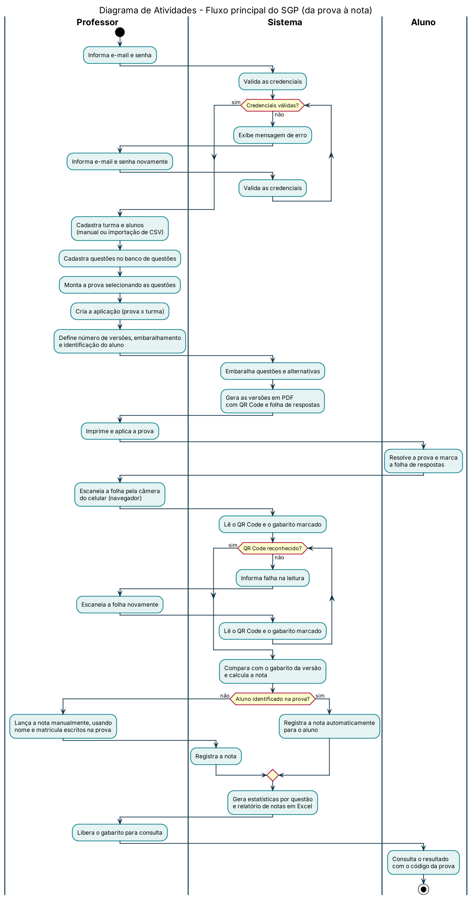
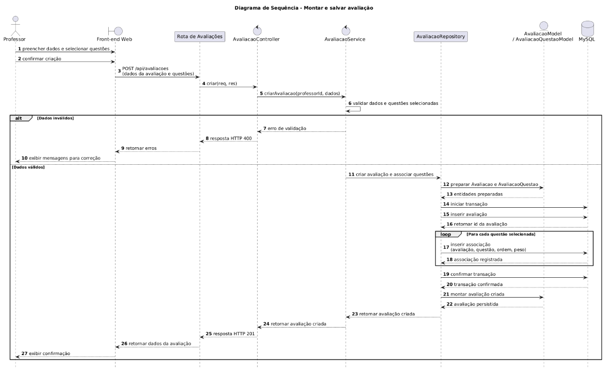

# SGP - Sistema de Geracao de Provas — Guia de Modelagem UML

## 📋 Cenário Base

> *"O cliente (professor) precisa de uma solução para otimizar o tempo gasto na correção de grandes volumes de provas. O sistema deve permitir criar e organizar provas (embaralhando questões e alternativas para evitar cola), gerar folhas de respostas com QR code/gabarito e realizar a correção automatizada através da leitura dessas folhas. Além disso, o sistema deve oferecer relatórios de notas e análises estatísticas sobre o desempenho dos alunos para auxílio pedagógico."*

---

## 1️⃣ Diagrama de Casos de Uso

### 🔎 Passo 1A — Análise do Cenário ("Caça aos Atores e Ações")

**Atores identificados:**

| Ator | Papel no sistema |
|---|---|
| `Professor` | Responsável pela gestão académica de avaliações, desde a importação de alunos, elaboração e correção de exames até à emissão de relatórios e estatísticas. |
| `Aluno` | Responsável por identificar-se e por consultar os seus resultados. |

**Ações / Casos de uso identificados:**

- Importar lista de alunos
- Criar e editar provas 
- Gerar provas
- Gerar gabarito
- Corrigir prova
- Consultar avaliação
- Gerar estatística das respostas 
- Gerar relatório de notas
- Editar layout da prova
- Identificar-se na prova
- Consultar resultado

### 🖼️ Diagrama de Caso de Uso

### 1B. Passo a passo da criação

1. Leitura do cenário base e dos requisitos funcionais (RF01 a RF12) do README.
2. Identificação dos atores externos, isto é, quem interage com o sistema sem fazer parte dele: Professor e Aluno.
3. Levantamento das ações de cada ator, escritas no formato verbo + objeto (ex.: "Importar lista de alunos", "Consultar resultado").
4. Desenho da fronteira do sistema (retângulo) no app.diagrams.net, com os casos de uso dentro dela e os atores fora: Professor à esquerda e Aluno à direita.
5. Ligação de cada ator aos seus casos de uso por linhas de associação.
6. Conferência de que cada caso de uso corresponde a pelo menos um requisito funcional e exportação do diagrama em PNG para `docs/uml/casodeuso.png`.

---

## 2️⃣ Diagrama de Atividades

### 🔎 Passo 2A — Análise do Fluxo Cronológico

O diagrama representa o fluxo principal do SGP, desde o login do professor até a consulta da nota pelo aluno, seguindo o "Fluxo Resumido" da Especificação (seção 4). Foram identificados três responsáveis (raias): **Professor**, **Sistema** e **Aluno**.

Ações em ordem cronológica:

1. O professor faz login; se as credenciais forem inválidas, o sistema exibe erro e o professor tenta novamente.
2. O professor cadastra turma e alunos, cadastra questões, monta a prova e cria a aplicação (prova x turma).
3. O professor define número de versões, embaralhamento e se haverá identificação do aluno.
4. O sistema embaralha questões e alternativas e gera as versões em PDF com QR Code e folha de respostas.
5. O professor imprime e aplica a prova; o aluno a resolve e marca a folha de respostas.
6. O professor escaneia a folha (câmera do celular, pelo navegador); se o QR Code não for reconhecido, o sistema informa a falha e o professor escaneia novamente.
7. O sistema compara com o gabarito da versão e calcula a nota.
8. Decisão "Aluno identificado na prova?": se **sim**, o sistema registra a nota automaticamente; se **não**, o professor lança a nota manualmente usando nome e matrícula escritos na prova.
9. O sistema gera estatísticas por questão e o relatório de notas em Excel.
10. O professor libera o gabarito e o aluno consulta o resultado.

### 2B. Raias

| Raia | Responsabilidade |
|------|------------------|
| Professor | Login, cadastros, montagem da prova, aplicação, escaneamento, lançamento manual de nota, liberação do gabarito |
| Sistema | Validação de login, embaralhamento, geração dos PDFs, leitura do QR Code/gabarito, cálculo e registro da nota, estatísticas e relatórios |
| Aluno | Resolução da prova e consulta do resultado |

### 🖼️ Diagrama de Atividades

*Figura – Diagrama de Atividades do SGP. Decisões: login válido, QR Code reconhecido e aluno identificado na prova. Observação: o escaneamento foi modelado pela câmera no navegador, conforme o README (RNF05).*

### 2D. Passo a passo da criação

1. Leitura do fluxo resumido da Especificação e do enunciado da atividade.
2. Listagem das ações em ordem cronológica e separação por responsável.
3. Identificação das decisões e dos laços de repetição (login e escaneamento).
4. Escrita do diagrama em PlantUML (raias, `while`, `if/else`) e renderização.
5. Revisão do fluxo de ponta a ponta e salvamento do PNG em `docs/uml/`.
   

## 3️⃣ Diagrama de Classes

### 🔎 Passo 3A — Extração do Texto ("Truque do Detetive")

#### Identificando as classes (substantivos)

| Classe | Descrição |
|---|---|
| **Professor** | Quem cria as questões e monta/gerencia as avaliações |
| **Avaliacao** | O registro central da prova aplicada |
| **Turma** | Quem agrupa os alunos e é vinculada às avaliações aplicadas |
| **Aluno** | Quem é corrigido nas avaliações aplicadas à sua turma |
| **Questao** | Item do banco de questões, reaproveitado na montagem das avaliações |

**Interpretando associações e multiplicidades**

Pergunta-chave: *"Quantos desse podem estar ligados a aquele?"*

- **Professor ↔ Questao:** Um Professor pode criar zero ou várias questões (`0..*`). Uma Questão é criada por um, e somente um, Professor (`1`). → Associação simples `1` — `0..*`.
- **Professor ↔ Avaliacao:** Um Professor pode montar várias avaliações (`0..*`). Uma Avaliação é montada por um, e somente um, Professor (`1`). → Associação simples `1` — `0..*`.
- **Turma ↔ Aluno:** Uma Turma pode possuir vários alunos (`0..*`). Um Aluno pertence a uma, e somente uma, Turma (`1`). → Associação simples `1` — `0..*`.
- **Turma ↔ Avaliacao:** Uma Turma pode ser avaliada em várias avaliações ao longo do tempo (`0..*`). Uma Avaliação é aplicada a uma, e somente uma, Turma (`1`). → Associação simples `1` — `0..*`.
- **Avaliacao ↔ Questao:** Uma Avaliação pode conter várias questões (`0..*`), e uma Questão pode compor várias avaliações diferentes, pois é reaproveitada do banco de questões (`0..*`). → Associação muitos-para-muitos `0..*` — `0..*`.
- **Aluno ↔ Avaliacao:** Um Aluno pode ser corrigido em várias avaliações ao longo do tempo (`0..*`), e uma Avaliação corrige vários alunos (`0..*`). → Associação muitos-para-muitos `0..*` — `0..*`.

### 🖼️ Diagrama de Classes

---

## 4️⃣ Diagrama de Sequência

### 🔎 Passo 4A — Como Analisar e Ler o Diagrama

**Regra de ouro:** leia de cima para baixo; quanto mais abaixo a mensagem aparece, mais tarde ela acontece.

Cenário analisado: **Montar e salvar avaliação no SGP.**

Pré-condição: **o Professor já está autenticado no sistema**. O login não faz parte desta sequência.

1. **Atores e objetos (o elenco):** no topo estão `Professor`, `Front-end Web`, `Rota de Avaliações`, `AvaliacaoController`, `AvaliacaoService`, `AvaliacaoRepository`, `AvaliacaoModel`/`AvaliacaoQuestaoModel` e `MySQL`.
2. **Linhas de vida (o tempo passando):** as linhas tracejadas verticais representam cada participante ao longo da interação.
3. **Mensagens (os diálogos):** as setas contínuas representam solicitações ou chamadas entre participantes; as setas tracejadas representam retornos.
4. **Sequência principal:** o Professor preenche os dados e seleciona questões no Front-end. O Front-end envia a solicitação à API, que encaminha a operação pela rota, controller e service. O service valida os dados e as questões. Com dados válidos, o repository prepara as entidades, inicia uma transação no MySQL, grava a avaliação e associa cada questão selecionada com sua ordem e peso. Após confirmar a transação, o sistema retorna os dados da avaliação criada ao Front-end, que confirma o sucesso ao Professor.
5. **Bloco `alt` (alternativas/decisões):** representa a validação dos dados. Se forem inválidos, a API retorna HTTP 400 e o Front-end apresenta as mensagens para correção. Se forem válidos, a avaliação é persistida e o sistema retorna HTTP 201.
6. **Responsabilidade do Model e do Repository:** o Model representa e prepara as entidades do domínio; o Repository é responsável pelo acesso ao banco de dados. O Model não acessa o MySQL diretamente.

### 🖼️ Diagrama de Sequência

