<div align="center">

# 🚀 SGP — Sistema de Geração de Provas

**Plataforma web em desenvolvimento para professores organizarem turmas, criarem questões e montarem avaliações.**

🔗 **Link do sistema hospedado:** https://projeto-arquitetura-iota.vercel.app/

> **Estado da N2:** login/cadastro, turmas e alunos, banco de questões e avaliações são persistidos pela API Express no MySQL. A geração de arquivos, leitura/correção de respostas e estatísticas ainda não estão implementadas; a interface informa essa indisponibilidade e não apresenta notas simuladas.


</div>

## 👥 Equipe

| Nome completo | Papel / principais frentes no projeto |
|---|---|
| Erick Andrei Demathé | |
| Gabriel Hoeft Tissi | |
| Henrique Cezar da Silveira | Setup inicial, Front-end, Versionamento, Documentação |
| Renan Gabriel Piechontcoski | |
| Tasciane Negelski Broca | Diagramas UML (casos de uso), API de turmas e importação de alunos por CSV, integração das turmas no front-end, README v2 |

## 📑 Sumário

- [1. Visão Geral](#1-visão-geral)
- [2. Requisitos](#2-requisitos)
  - [2.1 Funcionais (RF)](#21-funcionais-rf)
  - [2.2 Não Funcionais (RNF)](#22-não-funcionais-rnf)
- [3. Modelagem (UML)](#3-modelagem-uml)
- [4. Telas do Sistema](#4-telas-do-sistema)
- [5. Arquitetura de Software](#5-arquitetura-de-software)
- [6. Decisões Arquiteturais (ADRs)](#6-decisões-arquiteturais-adrs)
- [7. Modelo de Dados](#7-modelo-de-dados)
- [8. Stack Tecnológica](#8-stack-tecnológica)
- [9. Estrutura de Pastas](#9-estrutura-de-pastas)
- [10. Como Executar o Projeto](#10-como-executar-o-projeto)
- [11. Especificação da API](#11-especificação-da-api)
- [12. Testes e Validações](#12-testes-e-validações)
- [13. Manual do Usuário](#13-manual-do-usuário)
- [14. Equipe e Contribuições](#14-equipe-e-contribuições)

---

## 1. Visão Geral

📌 **N1**

🎯 **Objetivo:**

Professores com carga horária alta enfrentam um volume grande de provas para corrigir manualmente a cada avaliação (200 a 400 provas por semana de provas), o que consome tempo e atrasa a devolutiva da nota ao aluno. O **SGP (Sistema de Geração de Provas)** resolve esse problema automatizando a criação, a geração e a correção de provas: o professor monta um banco de questões, gera variações embaralhadas da prova em PDF e corrige as folhas de resposta escaneando-as pela câmera do celular direto no navegador, com a nota calculada automaticamente. O sistema é feito para professores e alunos de instituições de ensino que precisam agilizar a correção de avaliações objetivas em turmas grandes.

📌 **Escopo Definido:**
O sistema permite que o professor:
- Monte um banco de questões (enunciado, alternativas e resposta correta);
- Gere avaliações a partir desse banco, separando o caderno de questões da folha de respostas;
- Gere múltiplas variações da mesma prova, com embaralhamento automático de questões e alternativas;
- Gere a folha de respostas em PDF, com marcações de calibração e QR Code identificando a variação;
- Corrija as provas escaneando as folhas de resposta pela câmera do celular, direto no navegador (sem app nativo);
- Consulte relatórios estatísticos por questão e exporte notas e resultados individuais em Excel;
- Exporte o caderno de provas em formato editável (.doc);
- Importe listas de alunos e gere provas individualizadas com o nome impresso na folha de resposta.

**Fora do escopo (por enquanto):** aplicativo mobile nativo — o escaneamento é feito pela interface web responsiva, direto no navegador do celular.

## 2. Requisitos

📌 **N1** (podem ser ajustados nas entregas seguintes, se o escopo mudar)

### 2.1 Funcionais (RF)

| Código | Requisito |
|---|---|
| RF01 | O sistema deve permitir o cadastro e a autenticação (login) de professores. |
| RF02 | O sistema deve permitir a criação e o gerenciamento de um banco de questões (enunciado, alternativas e indicação da resposta correta). |
| RF03 | O sistema deve permitir a montagem de avaliações, separando logicamente o caderno de questões da folha de respostas. |
| RF04 | O sistema deve gerar múltiplas variações da mesma prova, embaralhando automaticamente a ordem das questões e das alternativas. |
| RF05 | O sistema deve permitir a importação de listas de alunos (Excel/CSV) para gerar provas individualizadas (nome impresso na folha de resposta) |
| RF06 | O sistema deve exportar o caderno de provas em formato editável (.doc) para que o professor possa ajustar quebras de página, caso necessário |
| RF07 | O sistema deve gerar a folha de respostas em PDF, contendo marcações de calibração para a câmera e um QR Code único que identifique qual é a variação da prova/aluno. |
| RF08 | O sistema deve acessar a câmera do smartphone pelo navegador (Web App) para escanear as folhas de resposta em lote. |
| RF09 | O sistema deve processar a imagem do gabarito, cruzar com a variação correta da prova e calcular a nota do aluno automaticamente. |
| RF10 | O sistema deve prover uma rota de consulta para que o aluno possa verificar sua nota utilizando o código impresso em sua prova. |
| RF11 | O sistema deve gerar relatórios estatísticos por avaliação, indicando a taxa de acertos e qual alternativa incorreta foi a mais assinalada por questão. |
| RF12 | O sistema deve exportar um relatório final em Excel contendo a nota e detalhando qual alternativa cada aluno marcou em cada questão. |

### 2.2 Não Funcionais (RNF)

Restrições e qualidades do sistema (desempenho, segurança, usabilidade, compatibilidade), não é uma funcionalidade que o usuário aciona diretamente. Exemplo:

| Código | Requisito |
|---|---|
| RNF01 | O back-end deve ser desenvolvido em Node.js com o framework Express. |
| RNF02 | O banco de dados utilizado deve ser o MySQL. |
| RNF03 | A aplicação deve respeitar estritamente a arquitetura em camadas: Rota → Controle → Serviço → Repositório → Model. |
| RNF04 | A interface de usuário web deve ser responsiva, minimalista e focar na usabilidade (poucos cliques para as tarefas principais). |
| RNF05 | O escaneamento (correção das provas) deve ser executado no próprio navegador do celular, sem a necessidade de um aplicativo mobile. |
| RNF06 | As senhas dos usuários devem ser armazenadas de forma segura utilizando criptografia. |

## 3. Modelagem (UML)

Os diagramas UML e o passo a passo de análise estão documentados em
[N2-P1.md](N2-P1.md). Os arquivos disponíveis em `docs/uml/` incluem
[casos de uso](docs/uml/casodeuso.png), [classes](docs/uml/diagrama-classes.png),
[atividades do SGP](docs/uml/diagrama-atividades-sgp.png),
[atividades de correção](docs/uml/diagrama-atividades-corrigir-provas.png) e
[sequência](docs/uml/sequencia.png). O banco da T07 segue o modelo de oito entidades.

📌 **N2**

Diagrama de casos de uso, diagrama de classes e diagrama de atividades do sistema (e demais diagramas que forem necessários). Os diagramas são escritos em PlantUML (fonte em `docs/uml/*.puml`) e exportados como PNG para a mesma pasta.

### Diagrama de Classes

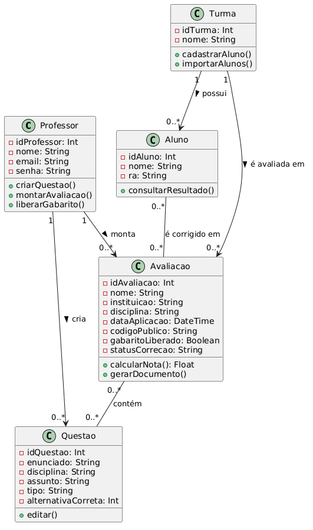

Representa as principais entidades do domínio do SGP: `Professor`, `Turma`, `Aluno`, `Questao` e `Avaliacao`. O professor cria questões e monta avaliações; a turma possui alunos e é vinculada a uma avaliação; a avaliação é composta por questões (relação muitos-para-muitos) e, na correção, associada aos alunos corrigidos.

### Diagrama de Atividades — Corrigir Provas

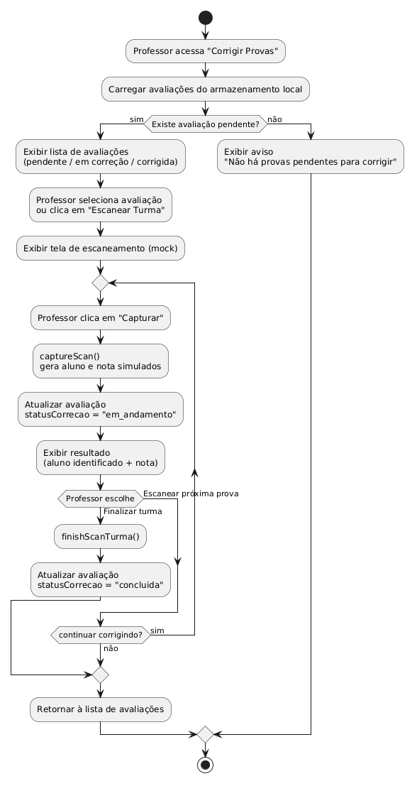

Descreve o fluxo de atividades da correção de provas, incluindo o desvio de decisão quando não há avaliação pendente, o laço de captura de alunos (repetido a cada "Capturar") e o ponto de decisão entre "Escanear próxima prova" e "Finalizar turma", que encerra o laço e atualiza o status da avaliação para "concluída".

**Sequência lógica extraída do fluxo:**

1. Professor acessa a tela "Corrigir Provas".
2. O sistema carrega as avaliações cadastradas no armazenamento local.
3. **Decisão:** existe avaliação pendente de correção?
   - **[Não]** → Sistema exibe o aviso "Não há provas pendentes para corrigir" (fim).
   - **[Sim]** → Sistema exibe a lista de avaliações (pendente / em correção / corrigida).
4. Professor seleciona uma avaliação ou clica em "Escanear Turma".
5. Sistema exibe a tela de escaneamento (simulada, conforme escopo da N1).
6. Professor clica em "Capturar".
7. Sistema executa `captureScan()`, gerando aluno e nota simulados, e atualiza o status da avaliação para `"em_andamento"`.
8. Sistema exibe o resultado (aluno identificado + nota).
9. **Decisão:** o professor escolhe continuar corrigindo?
   - **[Escanear próxima prova]** → retorna ao passo 6.
   - **[Finalizar turma]** → Sistema executa `finishScanTurma()`, atualizando o status da avaliação para `"concluida"`.
10. Sistema retorna à lista de avaliações (fim).

**Raias identificadas:** o processo envolve apenas dois responsáveis — o Professor, que decide e interage, e o próprio Sistema, que processa e persiste os dados. Por isso o diagrama foi modelado sem raias (swimlanes): com só duas partes, raias não adicionam clareza, e um fluxo linear com pontos de decisão já representa bem o cenário.

| Responsável | Responsabilidades |
|---|---|
| **Professor** | Acessar a tela, selecionar avaliação, clicar em "Escanear Turma"/"Capturar", decidir entre escanear próxima prova ou finalizar turma |
| **Sistema (SGP)** | Carregar avaliações, exibir listas e telas, gerar aluno/nota simulados, atualizar e persistir o status da avaliação |

### Diagrama de Casos de Uso

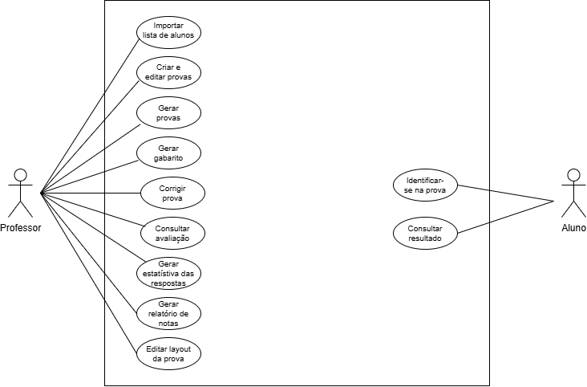

Mostra os dois atores externos do SGP e o que cada um faz no sistema. O **Professor** importa a lista de alunos, cria e edita provas, gera as provas e o gabarito, corrige as provas, consulta as avaliações, gera as estatísticas das respostas e o relatório de notas e edita o layout da prova. O **Aluno** se identifica na prova e consulta o seu resultado.

A análise do cenário, a lista de atores e casos de uso e o passo a passo da criação estão em [N2-P1.md](N2-P1.md).

## 4. Telas do Sistema

📌 **N1**

Prints das telas principais, na ordem do fluxo de navegação (a tela A leva à tela B):

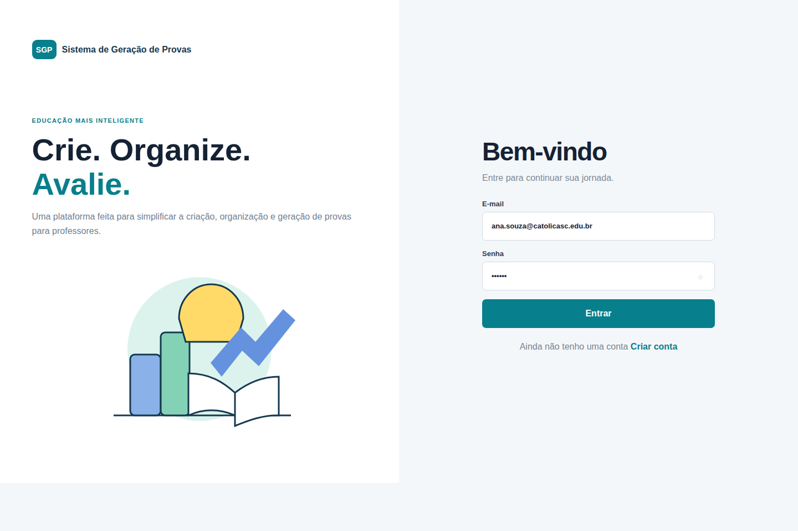
*Tela de login: autenticação do usuário por e-mail e senha, com opção de criar conta.*

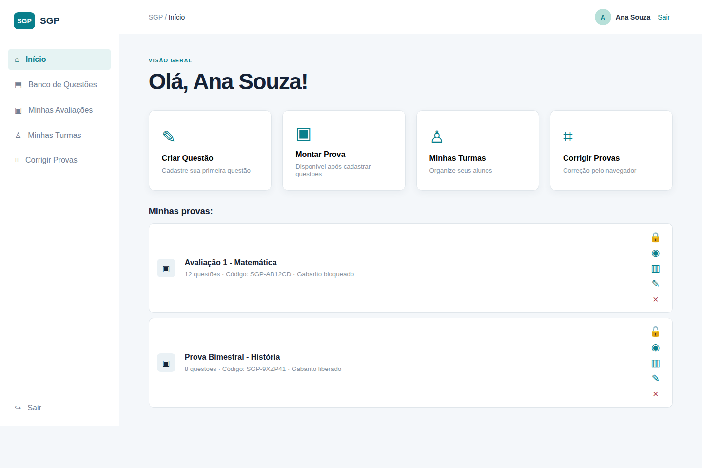
*Início: visão geral do professor, com atalhos para as principais ações e a lista de provas já criadas.*

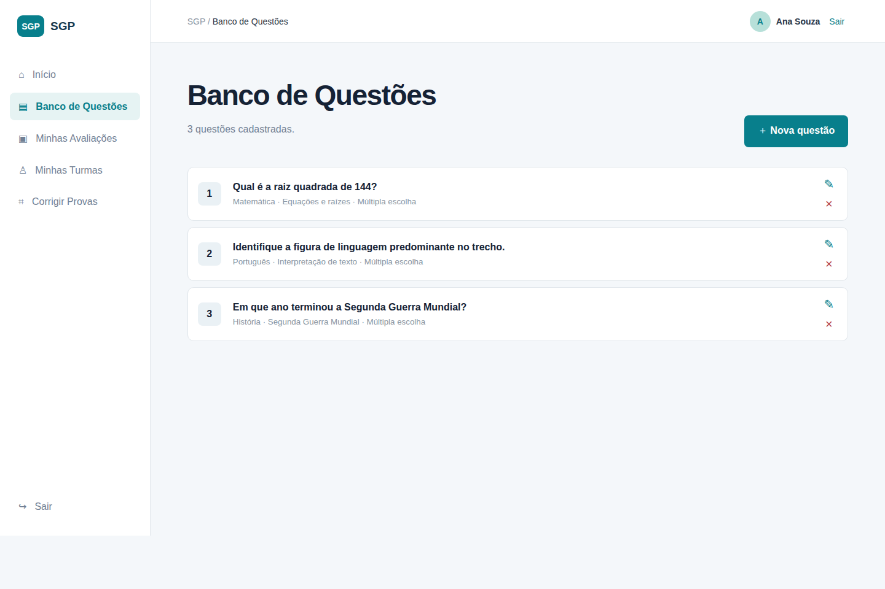
*Banco de Questões: lista as questões cadastradas, com opções de editar e remover.*

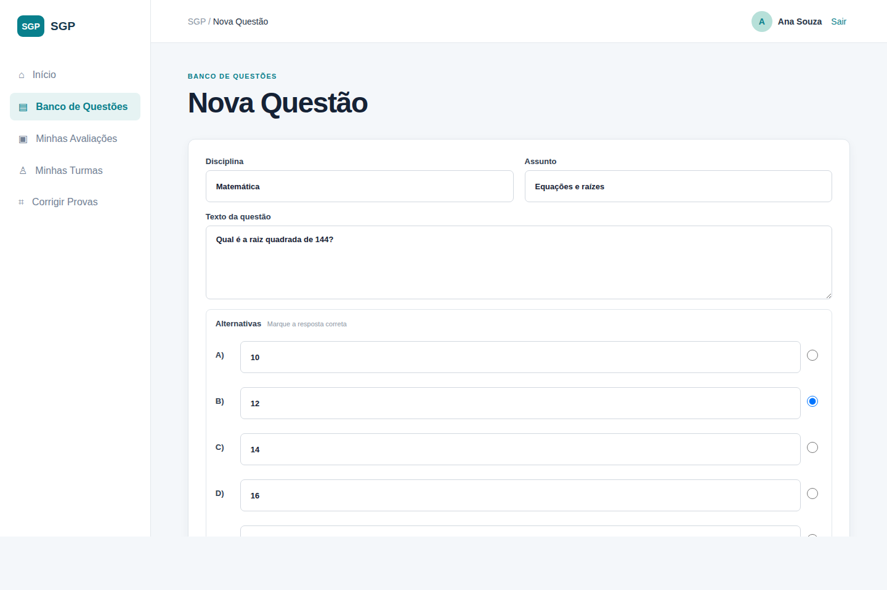
*Nova Questão: cadastro de uma questão de múltipla escolha, com disciplina, assunto, alternativas e marcação da resposta correta.*

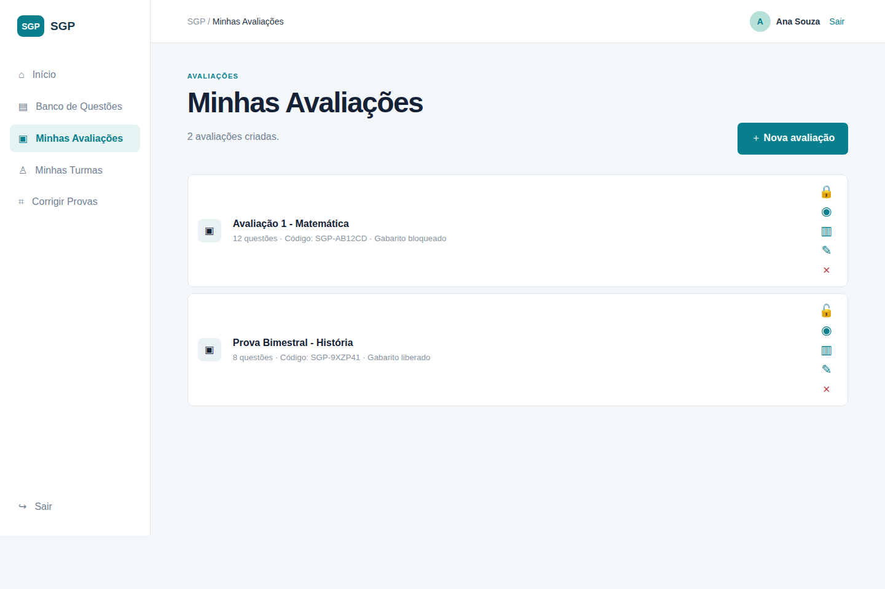
*Minhas Avaliações: lista as provas montadas, com o código público, o status do gabarito e ações de pré-visualizar, ver estatísticas, editar e remover.*

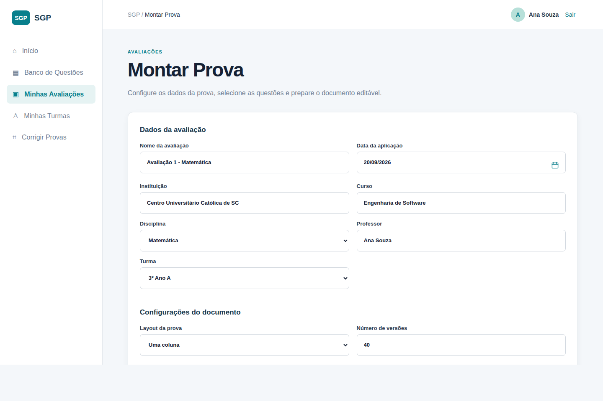
*Montar Prova: configuração dos dados da avaliação (instituição, disciplina, turma, layout) e seleção das questões do banco que vão compor a prova.*

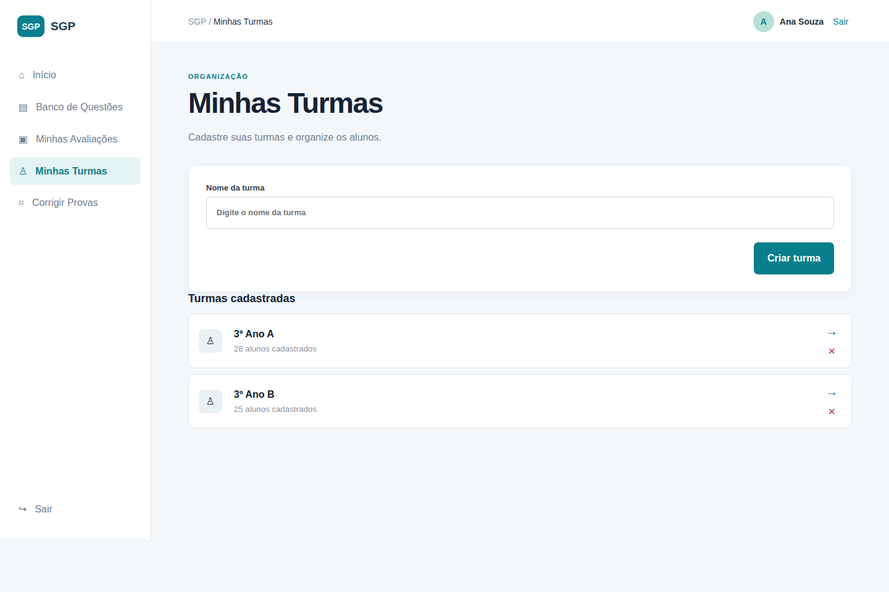
*Minhas Turmas: cadastro das turmas do professor, com a contagem de alunos de cada uma.*

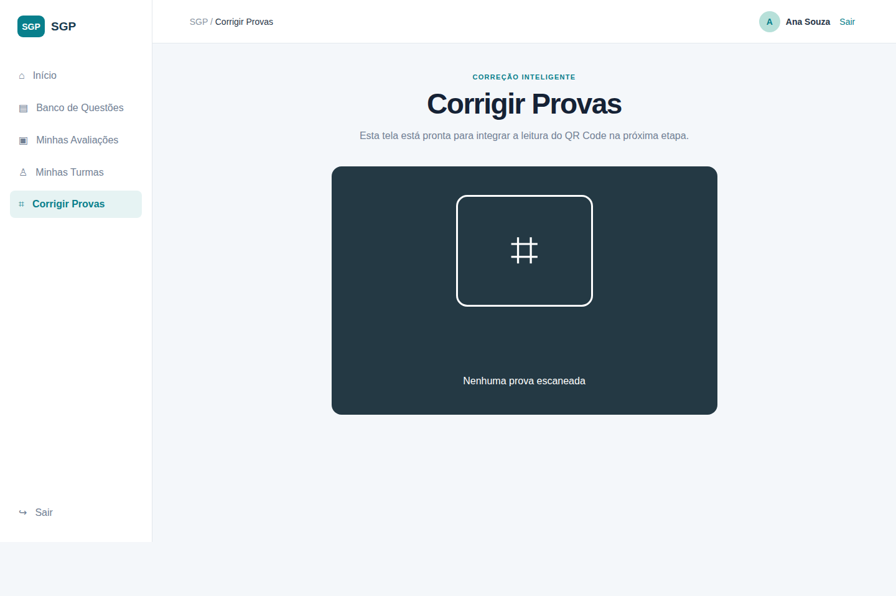
*Corrigir Provas: tela reservada para a leitura das folhas de resposta pela câmera, a ser integrada nas próximas entregas.*

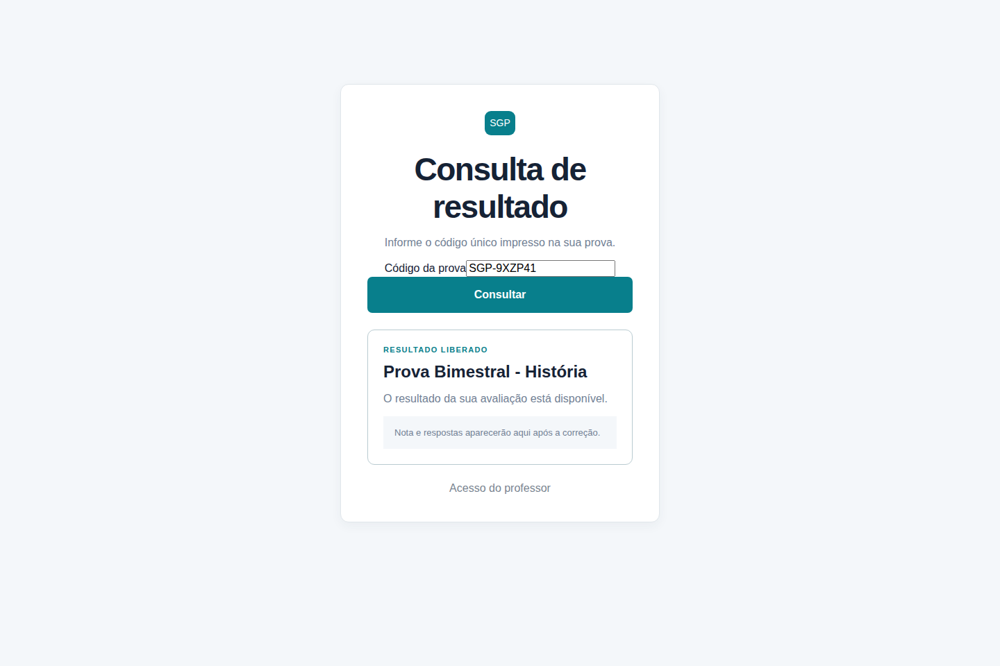
*Consulta do aluno: portal público onde o aluno informa o código da prova para ver se o resultado já foi liberado pelo professor.*

## 5. Arquitetura de Software

📌 **N3** (pode ser esboçada antes, mas passa a ser obrigatória na entrega final)

Estilo em camadas usado no projeto: `rota → controle → serviço → repositório → model`. Explique, em poucas linhas, a responsabilidade de cada camada (o que ela pode e não pode fazer) e como uma requisição passa por elas até chegar no banco de dados e voltar como resposta.

Insira aqui o **desenho da arquitetura** (diagrama de componentes/camadas), exportado como imagem e salvo em `docs/arquitetura/`:

```

```

## 6. Decisões Arquiteturais (ADRs)

📌 **N2** (primeiras decisões, como a escolha do banco e da estrutura de camadas) e **N3** (registro completo)

Um ADR (*Architecture Decision Record*) documenta uma decisão técnica importante: o que foi decidido, por quê, e quais as consequências. Crie um arquivo por decisão em `docs/adr/`, numerado (`ADR-001-nome-da-decisao.md`, `ADR-002-...`), seguindo este modelo mínimo dentro de cada arquivo:

```
# ADR-001: Título curto da decisão

## Contexto
Qual problema ou dúvida técnica motivou essa decisão.

## Decisão
O que a equipe decidiu fazer.

## Consequências
O que essa escolha facilita, o que ela custa ou limita.
```

Aqui no README, liste os ADRs (Registros de Decisão Arquitetural) criados (se necessário e houver), com link para cada arquivo:

- [ADR-001: Título da decisão](docs/adr/ADR-001-titulo-da-decisao.md)
- [ADR-002: Título da decisão](docs/adr/ADR-002-titulo-da-decisao.md)

## 7. Modelo de Dados

📌 **N2**

O banco MySQL (`sgp`) segue as oito entidades do diagrama de classes: `User`, `Class`,
`Enrollment`, `Question`, `Alternative`, `Exam`, `ExamQuestion` e `Application`. O script
de criação está em [`database/schema.sql`](database/schema.sql) e as regras de migração e
integridade em [`database/README.md`](database/README.md).

### Diagrama Entidade-Relacionamento

Gerado a partir do `schema.sql` (o GitHub renderiza o diagrama abaixo):

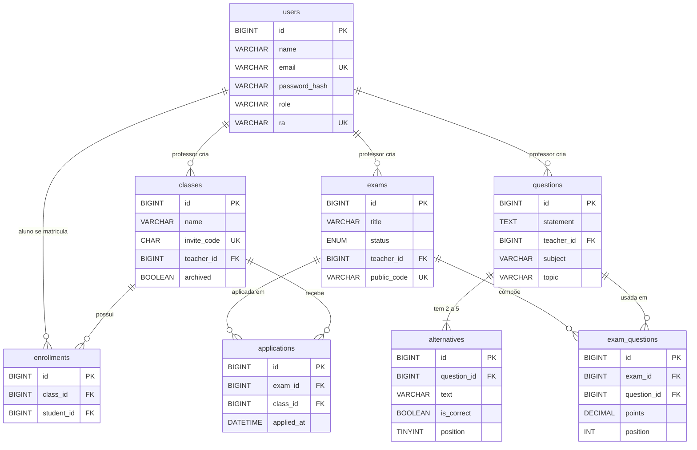

### Dicionário de Dados

Convenções: PK = chave primária, FK = chave estrangeira, UK = valor único. Todos os IDs são
`BIGINT UNSIGNED AUTO_INCREMENT`. As colunas técnicas `teacher_role` e `student_role` têm valor
fixo e existem só para que as FKs compostas `(id, role)` impeçam, por exemplo, um aluno de ser
dono de uma turma.

#### `users`: professores e alunos

| Campo | Tipo | Descrição |
|---|---|---|
| id | BIGINT UNSIGNED (PK) | Identificador do usuário |
| name | VARCHAR(120) | Nome completo (obrigatório) |
| email | VARCHAR(160) (UK) | E-mail de login, único em todo o sistema; obrigatório para professor |
| password_hash | VARCHAR(255) | Hash bcrypt da senha; obrigatório para professor |
| role | VARCHAR(9) | Papel: `professor` ou `aluno` |
| ra | VARCHAR(30) (UK) | Registro acadêmico do aluno (usado na importação por CSV) |
| created_at | TIMESTAMP | Data de criação do registro |

#### `classes`: turmas

| Campo | Tipo | Descrição |
|---|---|---|
| id | BIGINT UNSIGNED (PK) | Identificador da turma |
| name | VARCHAR(120) | Nome da turma |
| invite_code | CHAR(8) (UK) | Código de convite para o aluno entrar na turma |
| teacher_id | BIGINT UNSIGNED (FK → users) | Professor dono da turma |
| teacher_role | VARCHAR(9) | Técnico, sempre `professor` |
| description | VARCHAR(255) | Descrição opcional |
| archived | BOOLEAN | Indica se a turma foi arquivada (padrão `FALSE`) |
| created_at | TIMESTAMP | Data de criação |
| updated_at | TIMESTAMP | Data da última alteração |

#### `enrollments`: matrículas (aluno × turma)

| Campo | Tipo | Descrição |
|---|---|---|
| id | BIGINT UNSIGNED (PK) | Identificador da matrícula |
| class_id | BIGINT UNSIGNED (FK → classes) | Turma; apagar a turma remove as matrículas (cascade) |
| student_id | BIGINT UNSIGNED (FK → users) | Aluno matriculado |
| student_role | VARCHAR(9) | Técnico, sempre `aluno` |
| enrolled_at | DATETIME | Data da matrícula |

Um aluno só pode estar uma vez em cada turma (`UNIQUE (class_id, student_id)`).

#### `questions`: banco de questões

| Campo | Tipo | Descrição |
|---|---|---|
| id | BIGINT UNSIGNED (PK) | Identificador da questão |
| statement | TEXT | Enunciado |
| teacher_id | BIGINT UNSIGNED (FK → users) | Professor autor; cada professor vê só as suas questões |
| teacher_role | VARCHAR(9) | Técnico, sempre `professor` |
| subject | VARCHAR(120) | Disciplina |
| topic | VARCHAR(120) | Assunto |
| created_at | TIMESTAMP | Data de criação |
| updated_at | TIMESTAMP | Data da última alteração |

#### `alternatives`: alternativas de cada questão

| Campo | Tipo | Descrição |
|---|---|---|
| id | BIGINT UNSIGNED (PK) | Identificador da alternativa |
| question_id | BIGINT UNSIGNED (FK → questions) | Questão; apagar a questão remove as alternativas (cascade) |
| text | VARCHAR(255) | Texto da alternativa |
| is_correct | BOOLEAN | Indica a alternativa correta |
| position | TINYINT UNSIGNED | Ordem de 0 a 4 (A a E), única por questão |
| correct_marker | TINYINT (gerado) | Coluna calculada que garante no máximo uma correta por questão |

#### `exams`: provas

| Campo | Tipo | Descrição |
|---|---|---|
| id | BIGINT UNSIGNED (PK) | Identificador da prova |
| title | VARCHAR(120) | Título da prova |
| status | ENUM | `draft` (rascunho), `ready` (aplicada) ou `closed` (encerrada) |
| teacher_id | BIGINT UNSIGNED (FK → users) | Professor autor |
| teacher_role | VARCHAR(9) | Técnico, sempre `professor` |
| public_code | VARCHAR(20) (UK) | Código público da prova, para consulta do aluno |
| legacy_details | JSON | Metadados da avaliação herdados da versão N1 |
| created_at | TIMESTAMP | Data de criação |

#### `exam_questions`: questões de cada prova

| Campo | Tipo | Descrição |
|---|---|---|
| id | BIGINT UNSIGNED (PK) | Identificador do item |
| exam_id | BIGINT UNSIGNED (FK → exams) | Prova; apagar a prova remove os itens (cascade) |
| question_id | BIGINT UNSIGNED (FK → questions) | Questão usada |
| teacher_id | BIGINT UNSIGNED | Professor; garante que prova e questão são do mesmo dono |
| points | DECIMAL(6,2) | Pontuação da questão (maior que zero, padrão 1.00) |
| position | INT UNSIGNED | Ordem da questão na prova, única por prova |

#### `applications`: aplicação de uma prova a uma turma

| Campo | Tipo | Descrição |
|---|---|---|
| id | BIGINT UNSIGNED (PK) | Identificador da aplicação |
| exam_id | BIGINT UNSIGNED (FK → exams) | Prova aplicada |
| class_id | BIGINT UNSIGNED (FK → classes) | Turma que recebe a prova |
| teacher_id | BIGINT UNSIGNED | Professor; garante que prova e turma são do mesmo dono |
| applied_at | DATETIME | Data em que a prova foi aplicada |
| created_at | TIMESTAMP | Data de criação |

Cada prova só pode ser aplicada uma vez à mesma turma (`UNIQUE (exam_id, class_id)`).

## 8. Stack Tecnológica

📌 **N1** (lista inicial, pode crescer nas entregas seguintes)

Tecnologias usadas no projeto e por que cada uma foi escolhida. A stack obrigatória da disciplina é:


- **Node.js 22**: ambiente de execução do back-end.
- **Express 5**: framework das rotas e da API REST, organizada em camadas (rota → controller → serviço → repositório → model).
- **MySQL 8.4**: banco de dados relacional, acessado pela biblioteca **mysql2**, com pool de conexões e consultas parametrizadas.
- **bcrypt**: gera o hash das senhas antes de gravá-las no banco (RNF06).
- **jsonwebtoken (JWT)**: gera e valida o token de login que protege as rotas da API.
- **dotenv**: lê as configurações (banco, porta, segredo do JWT) do arquivo `.env`, que não vai para o GitHub.
- **Vue 3 + Vite**: front-end em página única; o Vite roda o ambiente de desenvolvimento e gera o build em `frontend/dist/`.
- **node:test**: executor de testes nativo do Node, usado no `npm test`.
- **Docker Compose**: sobe um MySQL local para desenvolvimento.
- **Hospedagem**: front-end na **Vercel**, API no **Render** e banco MySQL no **Aiven** (conexão com TLS). A Vercel encaminha as chamadas `/api` para o Render.
- **GitHub Actions**: valida o schema do banco em todo PR que altera a pasta `database/`.

## 9. Estrutura de Pastas

📌 **N1**, atualizada conforme o projeto cresce

```
frontend/
  index.html
  src/
    App.vue       # composição atual das telas N1
    constants/    # valores compartilhados da interface
    services/     # chamadas HTTP à API e utilitários da interface
    utils/        # funções reutilizáveis
    main.js
    styles.css
  package.json
  vite.config.js
src/
  config/         # configuração do back-end
  routes/         # rotas HTTP
  controllers/    # validação e orquestração
  services/       # regras de negócio
  repositories/   # acesso ao MySQL
  models/         # entidades e estruturas de dados
server.js         # servidor Express e entrega do build
docs/
  uml/            # diagramas UML
  telas/          # prints das telas
  arquitetura/    # documentação da arquitetura
  adr/            # decisões de arquitetura
  modelo-dados/   # modelo de dados
  api/            # documentação da API
```

## 10. Como Executar o Projeto

📌 **N1**, revisado a cada entrega (atualizado na N2: API conectada ao MySQL)

### Pré-requisitos

| Ferramenta | Versão usada |
|---|---|
| Node.js | 22.x (LTS) |
| npm | 10 ou superior (vem com o Node) |
| MySQL | 8.4 ou superior, instalado localmente **ou** via Docker |
| Git | qualquer versão recente |

### 1. Clonar e instalar as dependências

```
git clone https://github.com/Erickdemathe123/projeto-arquitetura-.git
cd projeto-arquitetura-
npm ci
```

### 2. Subir o banco MySQL

**Opção A: MySQL instalado na máquina.** Crie o banco e as tabelas com o script
de criação e, se quiser dados de teste, rode também o seed (apenas em desenvolvimento):

```
mysql -u root -p -e "CREATE DATABASE sgp CHARACTER SET utf8mb4 COLLATE utf8mb4_unicode_ci"
mysql -u root -p sgp < database/schema.sql
mysql -u root -p sgp < database/seed.sql
```

**Opção B: Docker.** O arquivo `docker-compose.yml` sobe um MySQL 8.4 na porta 3306
e, na primeira inicialização, aplica `schema.sql` e `seed.sql` automaticamente:

```
docker compose up -d
```

A senha do usuário `root` desse container é `sgp_dev_local` (somente para uso local).
Para recriar o banco do zero, rode `docker compose down -v` e suba de novo.

### 3. Configurar as variáveis de ambiente

Copie o modelo e preencha com os dados do seu MySQL (`cp` no Linux/macOS, `copy` no Windows):

```
cp .env.example .env
```

| Variável | Para que serve |
|---|---|
| `PORT` | Porta da API (padrão 3000) |
| `DB_HOST`, `DB_PORT` | Endereço do MySQL (`localhost` e `3306`) |
| `DB_USER`, `DB_PASSWORD` | Usuário e senha do MySQL (no Docker: `root` / `sgp_dev_local`) |
| `DB_NAME` | Nome do banco (`sgp`) |
| `DB_SSL` | Ativa TLS quando `true` (necessário para o Aiven) |
| `DB_SSL_CA_PATH` | Caminho para o CA certificate quando TLS estiver ativo |
| `JWT_SECRET`, `JWT_EXPIRES_IN` | Segredo e validade do token de login |

O `.env` está no `.gitignore` e nunca deve ser enviado ao GitHub.
Para usar o Aiven, configure as variáveis de banco no Render com `DB_NAME=defaultdb`,
`DB_SSL=true` e o caminho do CA certificate instalado como Secret File. Cadastre
a senha diretamente no painel do Render, nunca no repositório.

### 4. Executar

```
npm run build
npm start
```

O `npm run build` instala as dependências do front-end e gera `frontend/dist/`, que é
servido pelo Express em http://localhost:3000. Para desenvolver, use dois terminais:
`npm run dev:api` (API com reinício automático) e `npm run dev` (front-end no Vite).

### 5. Validar a conexão com o banco

Com o servidor rodando, acesse http://localhost:3000/health:

- `200 {"status":"ok","banco":"conectado"}`: API conectada ao MySQL.
- `503 {"status":"indisponivel","banco":"desconectado"}`: confira o MySQL e o `.env`.

### 6. Testes automatizados

```
npm test                          # API (não precisa de MySQL)
node database/test-schema.cjs     # schema e seed (precisa de MySQL com permissão para criar bancos)
```

Mais detalhes da API e da autenticação em [Base do back-end](docs/backend.md) e do banco em [database/README.md](database/README.md).

### 7. Estado atual da integração com o banco

Na N1, os dados ficavam no `localStorage` do navegador. Na N2, a API passa a persistir no MySQL. Situação de cada parte do sistema:

| Funcionalidade | Situação na N2 |
|---|---|
| Cadastro e login de professor (RF01) | Integrado à API e ao MySQL (T11 e T18), com senha criptografada (bcrypt) e token JWT |
| Turmas, matrículas e importação de alunos por CSV (RF05) | API pronta (T13 e T14) e tela "Minhas Turmas" ligada aos endpoints (T19), com rotas protegidas por login |
| Banco de questões (RF02) | Tela pronta para usar `/api/questoes` (T18); enquanto a API de questões (T12) não estiver no servidor, os dados ficam no navegador |
| Avaliações, correção e estatísticas (RF03 a RF12) | Ainda no `localStorage`; as tabelas `exams`, `exam_questions` e `applications` já existem no banco |
| Verificação de saúde (`/health`) | Consulta o MySQL e informa se o banco está conectado |

## 11. Especificação da API

📌 **N2**

Todas as rotas respondem em JSON. Nas rotas marcadas como **Professor** ou **Logado**, é preciso enviar o token recebido no login no cabeçalho `Authorization: Bearer <token>`. Os erros seguem o formato `{ "erro": "mensagem" }`.

| Método | Rota | Acesso | Descrição |
|---|---|---|---|
| GET | `/health` | Público | Verifica se a API está no ar e conectada ao MySQL |
| POST | `/api/auth/cadastro` | Público | Cadastra um usuário (professor ou aluno) |
| POST | `/api/auth/login` | Público | Faz login com e-mail e senha e devolve o token JWT |
| GET | `/api/auth/me` | Logado | Retorna os dados do usuário do token |
| POST | `/api/turmas/entrar` | Público | Aluno entra numa turma com o código de convite (`codigo`, `ra` e `nome`) |
| GET | `/api/turmas` | Professor | Lista as turmas do professor (`?arquivadas=true` lista as arquivadas) |
| POST | `/api/turmas` | Professor | Cria uma turma (`nome` e `descricao`) e gera o código de convite |
| GET | `/api/turmas/:id` | Professor | Detalha uma turma |
| PUT | `/api/turmas/:id` | Professor | Edita o nome e a descrição da turma |
| PATCH | `/api/turmas/:id/arquivar` | Professor | Arquiva a turma (com `{ "arquivada": false }`, desarquiva) |
| POST | `/api/turmas/:id/codigo` | Professor | Gera um novo código de convite |
| GET | `/api/turmas/:id/alunos` | Professor | Lista os alunos matriculados na turma |
| POST | `/api/turmas/:id/alunos` | Professor | Matricula um aluno (`ra` e `nome`); reaproveita o cadastro se o RA já existir |
| DELETE | `/api/turmas/:id/alunos/:alunoId` | Professor | Remove o aluno da turma |
| POST | `/api/turmas/:id/alunos/importar` | Professor | Importa alunos de um CSV (RF05) enviado como texto (`Content-Type: text/csv`), com as colunas `nome` e `RA` separadas por `;` ou `,` e até 1000 linhas; devolve as listas `matriculados`, `jaMatriculados` e `erros` (por linha) |

As rotas de questões (`/api/questoes`) serão documentadas aqui quando a T12 for entregue.

## 12. Testes e Validações

📌 **N3** (validações e tratamento de erros/casos de borda passam a ser cobrados nesta entrega)

Execute `npm test` na raiz para rodar os testes automatizados sem conectar ao MySQL. A suíte cobre autenticação, proteção por papel, validação de IDs, importação CSV, regras de validação de questões/avaliações e consulta pública sem exposição de respostas. A validação ponta a ponta com um banco MySQL de teste continua necessária para a entrega final.

## 13. Manual do Usuário

📌 **N3**

Guia rápido de como usar o sistema, do ponto de vista de quem vai operá-lo (o cliente), não do desenvolvedor: passo a passo das principais funcionalidades, com prints. Pode ficar em um arquivo separado, `docs/manual-usuario.md`, com o link a partir daqui:

📘 [Manual do Usuário](docs/manual-usuario.md)

## 14. Equipe e Contribuições

📌 **N1**, mantido até a N3

Nome: principais contribuições no projeto (ex.: telas de cadastro, integração com banco, documentação). Serve para deixar claro quem fez o quê na entrega da equipe; não substitui o diário de organização de tarefas individual de cada pessoa.

- **Erick Andrei Demathé**: criação do repositório, revisão e merge dos Pull Requests da equipe, fluxo mock de correção de provas.
- **Gabriel Hoeft Tissi**: principais contribuições.
- **Henrique Cezar da Silveira**: setup inicial do repositório e da estrutura de pastas, telas de autenticação (login/cadastro), banco de questões, montagem de avaliações e turmas, organização da estrutura Vue do front-end.
- **Renan Gabriel Piechontcoski**: documentação das telas do sistema (capturas de tela de todas as telas principais em `docs/telas/`) e atualização do README v1 com as imagens e legendas da seção 4.
- **Tasciane Negelski Broca**: diagramas UML de casos de uso e de classes (N1) e passo a passo do diagrama de casos de uso; API de turmas e matrículas e de importação de alunos por CSV; integração da tela de turmas ao back-end, com rotas protegidas por login; README v2.

---

<div align="center">

*README elaborado para a disciplina de Projeto e Arquitetura de Software*

</div>
