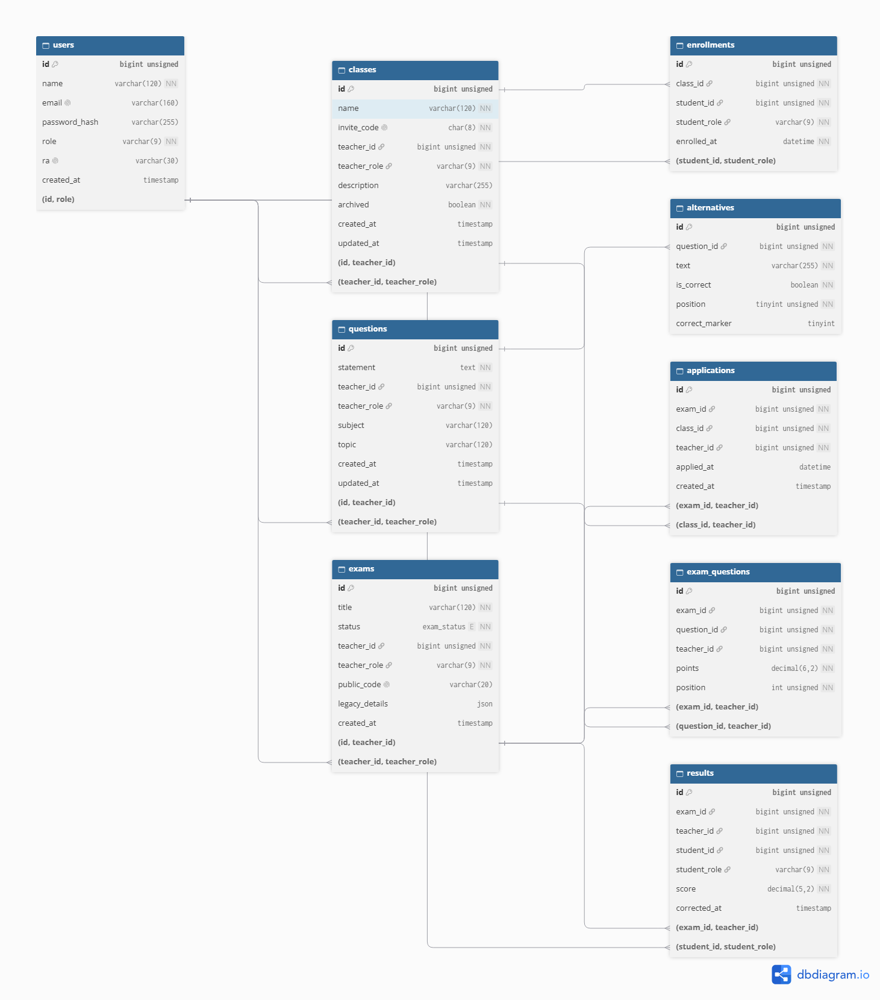

<div align="center">

# SGP — Sistema de Geração de Provas

**Plataforma web em desenvolvimento para professores organizarem turmas, criarem questões e montarem avaliações.**

🔗 **Link do sistema hospedado:** https://projeto-arquitetura-iota.vercel.app/

> **Estado da N2:** login/cadastro, turmas e alunos, banco de questões, avaliações, correção de provas (lançamento de notas) e consulta de resultado pelo aluno são persistidos pela API Express no MySQL. A geração de arquivos, a leitura automática de respostas (câmera/QR) e as estatísticas ainda não estão implementadas; a interface informa essa indisponibilidade.


</div>

## 👥 Equipe

| Nome completo | Papel / principais frentes no projeto |
|---|---|
| Erick Andrei Demathé | Diagramas UML (classes), Modelagem MER/DER (MySQL), API de provas e de aplicação |
| Gabriel Hoeft Tissi | Revisa/Entrega UML, Script SQL (DDL/Seed), API de questões, Testes e-2-e no ambiente hospedado, Empacotamento de entrega |
| Henrique Cezar da Silveira | Setup inicial, Front-end, Versionamento, Documentação, API (autenticação JWT e validações/tratamento de erros), Desição Arquitetural, Diagrama UML (sequência), Hospedagem (front-end, back-end e banco na nuvem), Revisão e merge de PRs |
| Renan Gabriel Piechontcoski | Diagramas UML (atividades), Dicionário de dados, Integração front-end (provas e aplicações), Remoção de mocks |
| Tasciane Negelski Broca | Diagramas UML (casos de uso), API de turmas e importação de alunos por CSV, integração das turmas no front-end, README v2 |

## 📑 Sumário

- [1. Visão Geral](#1-visão-geral)
- [2. Requisitos](#2-requisitos)
  - [2.1 Funcionais (RF)](#21-funcionais-rf)
  - [2.2 Não Funcionais (RNF)](#22-não-funcionais-rnf)
- [3. Modelagem (UML)](#3-modelagem-uml)
- [4. Telas do Sistema](#4-telas-do-sistema)
- [5. Arquitetura de Software](#5-arquitetura-de-software)
- [6. Decisões Arquiteturais (ADRs)](#6-decisões-arquiteturais-adrs)
- [7. Modelo de Dados](#7-modelo-de-dados)
- [8. Stack Tecnológica](#8-stack-tecnológica)
- [9. Estrutura de Pastas](#9-estrutura-de-pastas)
- [10. Como Executar o Projeto](#10-como-executar-o-projeto)
- [11. Especificação da API](#11-especificação-da-api)
- [12. Testes e Validações](#12-testes-e-validações)
- [13. Manual do Usuário](#13-manual-do-usuário)
- [14. Equipe e Contribuições](#14-equipe-e-contribuições)

---

## 1. Visão Geral

📌 **N1**

Professores com carga horária alta enfrentam um volume grande de provas para corrigir manualmente a cada avaliação (200 a 400 provas por semana de provas), o que consome tempo e atrasa a devolutiva da nota ao aluno. O **SGP (Sistema de Geração de Provas)** resolve esse problema automatizando a criação, a geração e a correção de provas: o professor monta um banco de questões, gera variações embaralhadas da prova em PDF e corrige as folhas de resposta escaneando-as pela câmera do celular direto no navegador, com a nota calculada automaticamente. O sistema é feito para professores e alunos de instituições de ensino que precisam agilizar a correção de avaliações objetivas em turmas grandes.

## 2. Requisitos

📌 **N1**

### 2.1 Funcionais (RF)

| Código | Requisito |
|---|---|
| RF01 | O sistema deve permitir o cadastro e a autenticação (login) de professores. |
| RF02 | O sistema deve permitir a criação e o gerenciamento de um banco de questões (enunciado, alternativas e indicação da resposta correta). |
| RF03 | O sistema deve permitir a montagem de avaliações, separando logicamente o caderno de questões da folha de respostas. |
| RF04 | O sistema deve gerar múltiplas variações da mesma prova, embaralhando automaticamente a ordem das questões e das alternativas. |
| RF05 | O sistema deve permitir a importação de listas de alunos (Excel/CSV) para gerar provas individualizadas (nome impresso na folha de resposta) |
| RF06 | O sistema deve exportar o caderno de provas em formato editável (.doc) para que o professor possa ajustar quebras de página, caso necessário |
| RF07 | O sistema deve gerar a folha de respostas em PDF, contendo marcações de calibração para a câmera e um QR Code único que identifique qual é a variação da prova/aluno. |
| RF08 | O sistema deve acessar a câmera do smartphone pelo navegador (Web App) para escanear as folhas de resposta em lote. |
| RF09 | O sistema deve processar a imagem do gabarito, cruzar com a variação correta da prova e calcular a nota do aluno automaticamente. |
| RF10 | O sistema deve prover uma rota de consulta para que o aluno possa verificar sua nota utilizando o código impresso em sua prova. |
| RF11 | O sistema deve gerar relatórios estatísticos por avaliação, indicando a taxa de acertos e qual alternativa incorreta foi a mais assinalada por questão. |
| RF12 | O sistema deve exportar um relatório final em Excel contendo a nota e detalhando qual alternativa cada aluno marcou em cada questão. |

### 2.2 Não Funcionais (RNF)

| Código | Requisito |
|---|---|
| RNF01 | O back-end deve ser desenvolvido em Node.js com o framework Express. |
| RNF02 | O banco de dados utilizado deve ser o MySQL. |
| RNF03 | A aplicação deve respeitar estritamente a arquitetura em camadas: Rota → Controle → Serviço → Repositório → Model. |
| RNF04 | A interface de usuário web deve ser responsiva, minimalista e focar na usabilidade (poucos cliques para as tarefas principais). |
| RNF05 | O escaneamento (correção das provas) deve ser executado no próprio navegador do celular, sem a necessidade de um aplicativo mobile. |
| RNF06 | As senhas dos usuários devem ser armazenadas de forma segura utilizando criptografia. |

## 3. Modelagem (UML)

📌 **N2**

### Diagrama de Classes


Representa as principais entidades do domínio do SGP: `Professor`, `Turma`, `Aluno`, `Questao` e `Avaliacao`. O professor cria questões e monta avaliações; a turma possui alunos e é vinculada a uma avaliação; a avaliação é composta por questões (relação muitos-para-muitos) e, na correção, associada aos alunos corrigidos.

### Diagrama de Atividades — Corrigir Provas


Descreve o fluxo de atividades da correção de provas, incluindo o desvio de decisão quando não há avaliação pendente, o laço de captura de alunos (repetido a cada `Capturar`) e o ponto de decisão entre `Escanear próxima prova` e `Finalizar turma`, que encerra o laço e atualiza o status da avaliação para `concluída`.

**Sequência lógica extraída do fluxo:**

1. Professor acessa a tela **Corrigir Provas** .
2. O sistema carrega as avaliações cadastradas no armazenamento local.
3. **Decisão:** existe avaliação pendente de correção?
   - **[Não]** → Sistema exibe o aviso "Não há provas pendentes para corrigir" (fim).
   - **[Sim]** → Sistema exibe a lista de avaliações (pendente / em correção / corrigida).
4. Professor seleciona uma avaliação ou clica em "Escanear Turma".
5. Sistema exibe a tela de escaneamento (simulada, conforme escopo da N1).
6. Professor clica em "Capturar".
7. Sistema executa `captureScan()`, gerando aluno e nota simulados, e atualiza o status da avaliação para `"em_andamento"`.
8. Sistema exibe o resultado (aluno identificado + nota).
9. **Decisão:** o professor escolhe continuar corrigindo?
   - **[Escanear próxima prova]** → retorna ao passo 6.
   - **[Finalizar turma]** → Sistema executa `finishScanTurma()`, atualizando o status da avaliação para `"concluida"`.
10. Sistema retorna à lista de avaliações (fim).

**Raias identificadas:** o processo envolve apenas dois responsáveis — o Professor, que decide e interage, e o próprio Sistema, que processa e persiste os dados. Por isso o diagrama foi modelado sem raias (swimlanes): com só duas partes, raias não adicionam clareza, e um fluxo linear com pontos de decisão já representa bem o cenário.

| Responsável | Responsabilidades |
|---|---|
| **Professor** | Acessar a tela, selecionar avaliação, clicar em "Escanear Turma"/"Capturar", decidir entre escanear próxima prova ou finalizar turma |
| **Sistema (SGP)** | Carregar avaliações, exibir listas e telas, gerar aluno/nota simulados, atualizar e persistir o status da avaliação |

### Diagrama de Casos de Uso


Mostra os dois atores externos do SGP e o que cada um faz no sistema. O **Professor** importa a lista de alunos, cria e edita provas, gera as provas e o gabarito, corrige as provas, consulta as avaliações, gera as estatísticas das respostas e o relatório de notas e edita o layout da prova. O **Aluno** se identifica na prova e consulta o seu resultado.

A análise do cenário, a lista de atores e casos de uso e o passo a passo da criação estão em [N2-P1.md](N2-P1.md).

### Diagrama de Sequencia


O diagrama representa o fluxo de criação e persistência de uma avaliação. O professor preenche os dados e seleciona as questões no front-end, que envia a solicitação à rota da API. A requisição passa pelo controller e pelo service, responsável por validar as informações e as questões selecionadas.

Se os dados forem inválidos, a API retorna HTTP 400 e o front-end apresenta mensagens para correção. Se forem válidos, o repository prepara a avaliação e suas associações com as questões e inicia uma transação no MySQL. A avaliação é inserida e cada questão selecionada é associada à prova com sua ordem e peso. Após a confirmação da transação, os dados da avaliação criada retornam pelas camadas até o front-end, que confirma o sucesso ao professor.

## 4. Telas do Sistema

📌 **N1**


*Tela de login: autenticação do usuário por e-mail e senha, com opção de criar conta.*


*Início: visão geral do professor, com atalhos para as principais ações e a lista de provas já criadas.*


*Banco de Questões: lista as questões cadastradas, com opções de editar e remover.*


*Nova Questão: cadastro de uma questão de múltipla escolha, com disciplina, assunto, alternativas e marcação da resposta correta.*


*Minhas Avaliações: lista as provas montadas, com o código público, o status do gabarito e ações de pré-visualizar, ver estatísticas, editar e remover.*


*Montar Prova: configuração dos dados da avaliação (instituição, disciplina, turma, layout) e seleção das questões do banco que vão compor a prova.*


*Minhas Turmas: cadastro das turmas do professor, com a contagem de alunos de cada uma.*


*Corrigir Provas: tela reservada para a leitura das folhas de resposta pela câmera, a ser integrada nas próximas entregas.*


*Consulta do aluno: portal público onde o aluno informa o código da prova para ver se o resultado já foi liberado pelo professor.*

## 5. Arquitetura de Software

📌 **N3** (pode ser esboçada antes, mas passa a ser obrigatória na entrega final)

Estilo em camadas usado no projeto: `rota → controle → serviço → repositório → model`. Explique, em poucas linhas, a responsabilidade de cada camada (o que ela pode e não pode fazer) e como uma requisição passa por elas até chegar no banco de dados e voltar como resposta.

Insira aqui o **desenho da arquitetura** (diagrama de componentes/camadas), exportado como imagem e salvo em `docs/arquitetura/`:

```

```

## 6. Decisões Arquiteturais (ADRs)

📌 **N2**

Um ADR (*Architecture Decision Record*) registra uma decisão técnica relevante,
incluindo o contexto que a motivou, a escolha adotada e suas consequências.
Os registros abaixo documentam as decisões que orientam a arquitetura e a
integração atual do SGP. A arquitetura em camadas e a stack Node.js, Express,
MySQL e Vue.js são restrições da disciplina; os ADRs registram como o projeto
as aplica e as decisões complementares tomadas pela equipe.

| ADR | Decisão | Situação |
|---|---|---|
| [ADR-001](docs/adr/ADR-001-arquitetura-em-camadas.md) | Organizar o back-end em camadas com responsabilidades separadas | Adotada |
| [ADR-002](docs/adr/ADR-002-mysql-relacional.md) | Usar MySQL como persistência relacional do sistema | Adotada |
| [ADR-003](docs/adr/ADR-003-autenticacao-jwt-bcrypt.md) | Autenticar usuários com JWT e armazenar senhas com bcrypt | Adotada |
| [ADR-004](docs/adr/ADR-004-hospedagem-em-nuvem.md) | Hospedar front-end, API e banco em serviços separados, com TLS no banco | Adotada |
| [ADR-005](docs/adr/ADR-005-dados-de-prototipo.md) | Não migrar dados de domínio do protótipo local para o banco | Adotada |

## 7. Modelo de Dados

📌 **N2**



### Dicionário de Dados

#### `users`: professores e alunos

| Campo | Tipo | Descrição |
|---|---|---|
| id | BIGINT UNSIGNED (PK) | Identificador único, gerado automaticamente |
| name | VARCHAR(120) NOT NULL | Nome do usuário |
| email | VARCHAR(160) (UK), NULL | E-mail; único quando informado e obrigatório para professores |
| password_hash | VARCHAR(255), NULL | Hash bcrypt da senha; obrigatório para professores |
| role | VARCHAR(9) NOT NULL | Papel do usuário: `professor` ou `aluno` |
| ra | VARCHAR(30) (UK), NULL | Registro acadêmico do aluno; único quando informado |
| created_at | TIMESTAMP, DEFAULT CURRENT_TIMESTAMP | Data e hora de criação do registro |

A restrição `CHECK` limita `role` a `professor` ou `aluno`. Outra restrição exige
`email` e `password_hash` quando o papel é `professor`. A chave única composta
`(id, role)` permite que outras tabelas referenciem simultaneamente o usuário e seu papel.

#### `classes`: turmas

| Campo | Tipo | Descrição |
|---|---|---|
| id | BIGINT UNSIGNED (PK) | Identificador único, gerado automaticamente |
| name | VARCHAR(120) NOT NULL | Nome da turma |
| invite_code | CHAR(8) (UK) NOT NULL | Código único de convite para ingresso na turma |
| teacher_id | BIGINT UNSIGNED (FK composta → `users.id`) NOT NULL | Identificador do professor responsável |
| teacher_role | VARCHAR(9) NOT NULL, DEFAULT `professor` | Campo técnico da FK composta; o `CHECK` exige o papel `professor` |
| description | VARCHAR(255), NULL | Descrição opcional da turma |
| archived | BOOLEAN NOT NULL, DEFAULT `FALSE` | Indica se a turma está arquivada |
| created_at | TIMESTAMP, DEFAULT CURRENT_TIMESTAMP | Data e hora de criação |
| updated_at | TIMESTAMP, DEFAULT CURRENT_TIMESTAMP, ON UPDATE CURRENT_TIMESTAMP | Data e hora da última atualização; atualizada automaticamente pelo MySQL |

A FK composta `(teacher_id, teacher_role)` referencia `(users.id, users.role)`,
impedindo que um aluno seja definido como professor responsável. A chave única
`(id, teacher_id)` é usada por outras tabelas para validar o professor proprietário.

#### `enrollments`: matrículas (aluno × turma)

| Campo | Tipo | Descrição |
|---|---|---|
| id | BIGINT UNSIGNED (PK) | Identificador único, gerado automaticamente |
| class_id | BIGINT UNSIGNED (FK → `classes.id`) NOT NULL | Turma da matrícula; ao excluir a turma, a matrícula também é excluída |
| student_id | BIGINT UNSIGNED (FK composta → `users.id`) NOT NULL | Aluno matriculado |
| student_role | VARCHAR(9) NOT NULL, DEFAULT `aluno` | Campo técnico da FK composta; o `CHECK` exige o papel `aluno` |
| enrolled_at | DATETIME NOT NULL, DEFAULT CURRENT_TIMESTAMP | Data e hora da matrícula |

As FKs `(student_id, student_role)` → `(users.id, users.role)` asseguram que a matrícula
seja de um aluno. A restrição `UNIQUE (class_id, student_id)` impede que o mesmo aluno
se matricule mais de uma vez na mesma turma.

#### `questions`: banco de questões

| Campo | Tipo | Descrição |
|---|---|---|
| id | BIGINT UNSIGNED (PK) | Identificador único, gerado automaticamente |
| statement | TEXT NOT NULL | Enunciado da questão |
| teacher_id | BIGINT UNSIGNED (FK composta → `users.id`) NOT NULL | Professor autor da questão |
| teacher_role | VARCHAR(9) NOT NULL, DEFAULT `professor` | Campo técnico da FK composta; o `CHECK` exige o papel `professor` |
| subject | VARCHAR(120), NULL | Disciplina relacionada à questão |
| topic | VARCHAR(120), NULL | Assunto ou tópico relacionado à questão |
| created_at | TIMESTAMP, DEFAULT CURRENT_TIMESTAMP | Data e hora de criação |
| updated_at | TIMESTAMP, DEFAULT CURRENT_TIMESTAMP, ON UPDATE CURRENT_TIMESTAMP | Data e hora da última atualização; atualizada automaticamente pelo MySQL |

A FK composta `(teacher_id, teacher_role)` → `(users.id, users.role)` assegura que o
autor seja um professor. A chave única `(id, teacher_id)` permite verificar a propriedade
da questão em `exam_questions`.

#### `alternatives`: alternativas de cada questão

| Campo | Tipo | Descrição |
|---|---|---|
| id | BIGINT UNSIGNED (PK) | Identificador único, gerado automaticamente |
| question_id | BIGINT UNSIGNED (FK → `questions.id`) NOT NULL | Questão à qual a alternativa pertence; a exclusão da questão remove suas alternativas |
| text | VARCHAR(255) NOT NULL | Texto da alternativa |
| is_correct | BOOLEAN NOT NULL | Indica se a alternativa é a resposta correta (`TRUE`/`1`) |
| position | TINYINT UNSIGNED NOT NULL | Posição da alternativa, de `0` a `4` (A a E), única por questão |
| correct_marker | TINYINT gerado | Coluna calculada: recebe `1` para alternativas corretas e `NULL` para as demais; índice único permite no máximo uma correta por questão |

O banco valida que `position` esteja entre `0` e `4` e que `is_correct` seja `0` ou `1`.
O limite de duas a cinco alternativas e a exigência de exatamente uma correta são
validados pela API; o índice técnico no banco impede duas respostas corretas na mesma questão.

#### `exams`: provas

| Campo | Tipo | Descrição |
|---|---|---|
| id | BIGINT UNSIGNED (PK) | Identificador único, gerado automaticamente |
| title | VARCHAR(120) NOT NULL | Título da prova |
| status | ENUM(`draft`, `ready`, `closed`) NOT NULL, DEFAULT `draft` | Estado: rascunho, pronta/aplicada ou encerrada |
| teacher_id | BIGINT UNSIGNED (FK composta → `users.id`) NOT NULL | Professor responsável pela prova |
| teacher_role | VARCHAR(9) NOT NULL, DEFAULT `professor` | Campo técnico da FK composta; o `CHECK` exige o papel `professor` |
| public_code | VARCHAR(20) (UK), NULL | Código público opcional e único para consulta da prova |
| legacy_details | JSON, NULL | Metadados da avaliação herdados da versão N1 |
| created_at | TIMESTAMP, DEFAULT CURRENT_TIMESTAMP | Data e hora de criação |

A FK composta `(teacher_id, teacher_role)` → `(users.id, users.role)` assegura que o
responsável seja um professor. A chave única `(id, teacher_id)` é usada para validar
a propriedade da prova nas tabelas relacionadas.

#### `exam_questions`: questões de cada prova

| Campo | Tipo | Descrição |
|---|---|---|
| id | BIGINT UNSIGNED (PK) | Identificador único do item, gerado automaticamente |
| exam_id | BIGINT UNSIGNED (FK composta → `exams.id`) NOT NULL | Prova que contém a questão; ao excluir a prova, o item também é excluído |
| question_id | BIGINT UNSIGNED (FK composta → `questions.id`) NOT NULL | Questão incluída na prova |
| teacher_id | BIGINT UNSIGNED (FK composta) NOT NULL | Identificador técnico usado nas FKs para validar a propriedade comum |
| points | DECIMAL(6,2) NOT NULL, DEFAULT `1.00` | Pontuação atribuída à questão; deve ser maior que zero |
| position | INT UNSIGNED NOT NULL | Ordem da questão na prova; única dentro da mesma prova |

As FKs `(exam_id, teacher_id)` → `(exams.id, exams.teacher_id)` e
`(question_id, teacher_id)` → `(questions.id, questions.teacher_id)` garantem que a
prova e a questão pertençam ao mesmo professor. Cada questão pode aparecer uma só vez
na prova (`UNIQUE (exam_id, question_id)`), e cada posição também é única por prova
(`UNIQUE (exam_id, position)`).

#### `applications`: aplicação de uma prova a uma turma

| Campo | Tipo | Descrição |
|---|---|---|
| id | BIGINT UNSIGNED (PK) | Identificador único da aplicação, gerado automaticamente |
| exam_id | BIGINT UNSIGNED (FK composta → `exams.id`) NOT NULL | Prova aplicada |
| class_id | BIGINT UNSIGNED (FK composta → `classes.id`) NOT NULL | Turma que recebe a prova |
| teacher_id | BIGINT UNSIGNED (FK composta) NOT NULL | Identificador técnico usado nas FKs para validar a propriedade comum |
| applied_at | DATETIME, NULL | Data e hora em que a prova foi aplicada |
| created_at | TIMESTAMP, DEFAULT CURRENT_TIMESTAMP | Data e hora de criação do registro |

As FKs `(exam_id, teacher_id)` → `(exams.id, exams.teacher_id)` e
`(class_id, teacher_id)` → `(classes.id, classes.teacher_id)` garantem que a prova e a
turma pertençam ao mesmo professor. Cada prova pode ser aplicada no máximo uma vez à
mesma turma (`UNIQUE (exam_id, class_id)`).

#### `results`: resultados dos alunos nas provas

| Campo | Tipo | Descrição |
|---|---|---|
| id | BIGINT UNSIGNED (PK) | Identificador único do resultado, gerado automaticamente |
| exam_id | BIGINT UNSIGNED (FK composta → `exams.id`) NOT NULL | Prova corrigida; ao excluir a prova, o resultado também é excluído |
| teacher_id | BIGINT UNSIGNED (FK composta) NOT NULL | Identificador técnico que associa o resultado ao professor responsável pela prova |
| student_id | BIGINT UNSIGNED (FK composta → `users.id`) NOT NULL | Aluno que recebeu a nota |
| student_role | VARCHAR(9) NOT NULL, DEFAULT `aluno` | Campo técnico da FK composta; o `CHECK` exige o papel `aluno` |
| score | DECIMAL(5,2) NOT NULL | Nota do aluno, limitada pelo banco ao intervalo de `0` a `10` |
| corrected_at | TIMESTAMP, DEFAULT CURRENT_TIMESTAMP | Data e hora em que o resultado foi registrado |

A FK `(exam_id, teacher_id)` → `(exams.id, exams.teacher_id)` vincula o resultado à
prova e ao professor responsável. A FK `(student_id, student_role)` → `(users.id, users.role)`
assegura que o destinatário seja um aluno. Cada aluno pode ter um único resultado por
prova (`UNIQUE (exam_id, student_id)`).

## 8. Stack Tecnológica

📌 **N1**

Tecnologias usadas no projeto e por que cada uma foi escolhida. A stack obrigatória da disciplina é:


- **Node.js 22**: ambiente de execução do back-end.
- **Express 5**: framework das rotas e da API REST, organizada em camadas (rota → controller → serviço → repositório → model).
- **MySQL 8.4**: banco de dados relacional, acessado pela biblioteca **mysql2**, com pool de conexões e consultas parametrizadas.
- **bcrypt**: gera o hash das senhas antes de gravá-las no banco (RNF06).
- **jsonwebtoken (JWT)**: gera e valida o token de login que protege as rotas da API.
- **dotenv**: lê as configurações (banco, porta, segredo do JWT) do arquivo `.env`, que não vai para o GitHub.
- **Vue 3 + Vite**: front-end em página única; o Vite roda o ambiente de desenvolvimento e gera o build em `frontend/dist/`.
- **node:test**: executor de testes nativo do Node, usado no `npm test`.
- **Docker Compose**: sobe um MySQL local para desenvolvimento.
- **Hospedagem**: front-end na **Vercel**, API no **Render** e banco MySQL no **Aiven** (conexão com TLS). A Vercel encaminha as chamadas `/api` para o Render.
- **GitHub Actions**: valida o schema do banco em todo PR que altera a pasta `database/`.

## 9. Estrutura de Pastas

📌 **N1**

```
.github/
  workflows/
    database.yml               # validação do schema MySQL no GitHub Actions
.vercel/
  project.json                 # metadados de vínculo do projeto com a Vercel
.gitignore                     # arquivos e diretórios ignorados pelo Git
LICENSE                        # licença do projeto
N2-P1.md                       # material/documentação da entrega N2-P1
database/
  schema.sql                   # estrutura e restrições do banco
  seed.sql                     # dados iniciais/de desenvolvimento
  test-schema.cjs              # validação automatizada do schema
docs/
  adr/                         # registros de decisões arquiteturais
  api/                         # documentação da API
  arquitetura/                 # documentação da arquitetura
  modelo-dados/                # diagrama MER/DER
  telas/                       # imagens das telas
  uml/                         # diagramas UML e fontes PlantUML
frontend/
  index.html
  public/
    manifest.webmanifest       # metadados da aplicação web
  src/
    App.vue                    # composição das telas
    constants/                 # constantes compartilhadas da interface
    services/                  # comunicação com a API
    utils/                     # funções utilitárias
    main.js
    styles.css
  package.json
  package-lock.json
  vercel.json                  # configuração de publicação/roteamento na Vercel
  vite.config.js
src/
  config/                      # configuração do banco e do back-end
  controllers/                 # validação de entrada e orquestração
  errors/                      # erros da aplicação
  middlewares/                 # autenticação, validação e tratamento de erros
  models/                      # estruturas das entidades
  repositories/                # acesso e consultas ao MySQL
  routes/                      # definição dos endpoints HTTP
  services/                    # regras de negócio
  app.js                       # configuração da aplicação Express
test/
  fixtures/                    # schemas usados como dados de teste
  *.test.js                    # testes automatizados da API
.env.example                   # exemplo das variáveis de ambiente
docker-compose.yml             # MySQL local para desenvolvimento
package.json                   # dependências e comandos do back-end
package-lock.json
server.js                      # inicialização do servidor Express
```

## 10. Como Executar o Projeto

📌 **N1**

### Acessar a versão publicada

A versão web está disponível em [projeto-arquitetura-iota.vercel.app](https://projeto-arquitetura-iota.vercel.app/).
Na versão publicada, o front-end é servido pela Vercel, que encaminha as chamadas
`/api` para a API no Render. A API acessa o MySQL gerenciado no Aiven. Não é necessário
instalar Node.js, MySQL ou Docker para acessar o sistema.

### Executar localmente para desenvolvimento

Para desenvolver ou executar o projeto na própria máquina, são necessários:

| Ferramenta | Versão |
|---|---|
| Git | versão recente |
| Node.js | 22.x (LTS) |
| npm | 10 ou superior |
| Docker Desktop com Docker Compose | versão recente |

#### 1. Clonar o repositório e instalar as dependências

No PowerShell:

```powershell
git clone https://github.com/Erickdemathe123/projeto-arquitetura-.git
cd projeto-arquitetura-
npm ci
```

#### 2. Iniciar o MySQL local

O Docker Compose inicia um MySQL 8.4 na porta `3306`. Na primeira inicialização,
o container aplica `database/schema.sql` e `database/seed.sql`:

```powershell
docker compose up -d
```

A configuração local do container é `root` / `sgp_dev_local`, somente para
desenvolvimento. Para apagar o banco local e recriá-lo do zero, use
`docker compose down -v` e depois `docker compose up -d`. **Esse procedimento apaga
os dados armazenados no volume local.**

#### 3. Configurar as variáveis de ambiente

Crie o arquivo `.env` a partir do modelo:

```powershell
Copy-Item .env.example .env
```

Edite o `.env` com os dados do banco local. Para o Docker Compose, use
`DB_HOST=localhost`, `DB_PORT=3306`, `DB_USER=root`, `DB_PASSWORD=sgp_dev_local`
e `DB_NAME=sgp`. Mantenha `DB_SSL=false` no ambiente local.

| Variável | Para que serve |
|---|---|
| `PORT` | Porta da API; padrão `3000` |
| `DB_HOST`, `DB_PORT` | Endereço e porta do MySQL |
| `DB_USER`, `DB_PASSWORD` | Usuário e senha do MySQL |
| `DB_NAME` | Nome do banco; no Docker Compose, `sgp` |
| `DB_SSL` | Ativa TLS; use `false` localmente |
| `DB_SSL_CA_PATH` | Caminho do certificado CA, quando TLS estiver ativo |
| `JWT_SECRET`, `JWT_EXPIRES_IN` | Segredo e duração dos tokens de autenticação |

O `.env` contém configurações locais e não deve ser enviado ao GitHub.

#### 4. Iniciar a aplicação

Para executar a versão local compilada, gere o front-end e inicie o servidor:

```powershell
npm run build
npm start
```

O front-end compilado em `frontend/dist/` será servido pelo Express em
http://localhost:3000. Para desenvolvimento com atualização automática, abra dois
terminais: execute `npm run dev:api` em um e `npm run dev` no outro. O Vite ficará
disponível em http://localhost:5173 e encaminhará as chamadas `/api` para a API local.

#### 5. Verificar a conexão com o banco

Com o servidor rodando, acesse http://localhost:3000/health:

- `200 {"status":"ok","banco":"conectado"}` indica que a API está conectada ao MySQL.
- `503 {"status":"indisponivel","banco":"desconectado"}` indica que é necessário
  verificar se o banco está ativo e se os valores no `.env` estão corretos.

#### 6. Executar os testes

```powershell
npm test
```

Esse comando executa os testes da aplicação. Para validar também o schema e o seed
contra um MySQL local, execute:

```powershell
node database/test-schema.cjs
```

Para consultar os endpoints disponíveis, veja [Especificação da API](#11-especificação-da-api).

## 11. Especificação da API

📌 **N2**

As rotas da API usam o prefixo `/api`, exceto o endpoint de saúde `/health`.
As requisições com corpo JSON devem usar `Content-Type: application/json`.
Nas rotas protegidas, envie o token retornado pelo login no cabeçalho:

```http
Authorization: Bearer <token>
```

As rotas marcadas como **Professor** exigem autenticação e perfil de professor.
As respostas de erro seguem o formato `{ "erro": "mensagem" }`; exclusões bem-sucedidas
retornam `204 No Content`.

| Método | Rota | Acesso | Descrição |
|---|---|---|---|
| GET | `/health` | Público | Verifica a disponibilidade da API e a conexão com o MySQL; retorna `200` se conectado ou `503` se indisponível |
| POST | `/api/auth/cadastro` | Público | Cadastra usuário com `nome`, `role` (`professor` ou `aluno`) e, conforme o perfil, `email`, `senha` e/ou `ra`; retorna os dados públicos do usuário e token quando houver senha |
| POST | `/api/auth/login` | Público | Recebe `email` e `senha`; retorna os dados públicos do usuário e um token JWT |
| GET | `/api/auth/me` | Logado | Retorna os dados públicos do usuário associado ao token |
| POST | `/api/turmas/entrar` | Público | Matricula aluno usando `codigo`, `ra` e `nome` se o RA ainda não estiver cadastrado; se já existir, o nome não é necessário |
| GET | `/api/turmas` | Professor | Lista as turmas do professor; `?arquivadas=true` lista as arquivadas |
| POST | `/api/turmas` | Professor | Cria turma com `nome` e `descricao` opcional; gera o código de convite |
| GET | `/api/turmas/:id` | Professor | Retorna os dados de uma turma do professor |
| PUT | `/api/turmas/:id` | Professor | Atualiza `nome` e/ou `descricao` da turma |
| PATCH | `/api/turmas/:id/arquivar` | Professor | Arquiva a turma; envie `{ "arquivada": false }` para desarquivá-la |
| POST | `/api/turmas/:id/codigo` | Professor | Gera um novo código de convite para a turma |
| GET | `/api/turmas/:id/alunos` | Professor | Lista os alunos matriculados na turma |
| POST | `/api/turmas/:id/alunos` | Professor | Matricula aluno com `ra` e `nome` quando ainda não cadastrado; `email` é opcional |
| DELETE | `/api/turmas/:id/alunos/:alunoId` | Professor | Remove o aluno da turma |
| POST | `/api/turmas/:id/alunos/importar` | Professor | Importa CSV enviado como texto puro (`Content-Type: text/csv` ou `text/plain`), com colunas `nome` e `ra`, separadas por `;` ou `,`; aceita até 1000 alunos e retorna `total`, `matriculados`, `jaMatriculados` e `erros` por linha |
| GET | `/api/questoes` | Professor | Lista as questões do professor autenticado |
| POST | `/api/questoes` | Professor | Cria questão com `text`, `subject`, `topic`, `alternatives` (de 2 a 5 textos) e `correctAlternative` (índice começando em zero) |
| PUT | `/api/questoes/:id` | Professor | Atualiza os dados da questão usando os mesmos campos da criação |
| DELETE | `/api/questoes/:id` | Professor | Remove questão; retorna `409` se ela estiver vinculada a uma avaliação |
| GET | `/api/avaliacoes` | Professor | Lista as avaliações do professor autenticado |
| POST | `/api/avaliacoes` | Professor | Cria avaliação com `name` e `questionIds`; `applicationClassId` é opcional para aplicá-la a uma turma na criação |
| PUT | `/api/avaliacoes/:id` | Professor | Atualiza a avaliação usando os mesmos campos da criação |
| PATCH | `/api/avaliacoes/:id/gabarito` | Professor | Altera a liberação do gabarito com `{ "released": true }` ou `{ "released": false }` |
| DELETE | `/api/avaliacoes/:id` | Professor | Remove avaliação |
| GET | `/api/avaliacoes/codigo/:code` | Público | Consulta avaliação pelo código público; com `?ra=<RA>`, retorna também a nota correspondente quando o gabarito estiver liberado e houver resultado lançado para esse aluno |
| GET | `/api/avaliacoes/:id/resultados` | Professor | Lista os resultados da avaliação e retorna `totalMatriculados`, `corrigidos` e `status` (`pendente`, `em_andamento` ou `concluida`) |
| POST | `/api/avaliacoes/:id/resultados` | Professor | Registra ou atualiza nota com `ra` e `score` (de `0` a `10`); exige avaliação aplicada a uma turma e aluno matriculado nela |
| DELETE | `/api/avaliacoes/:id/resultados/:alunoId` | Professor | Remove o resultado do aluno na avaliação |

## 12. Testes e Validações

📌 **N3** (validações e tratamento de erros/casos de borda passam a ser cobrados nesta entrega)

Execute `npm test` na raiz para rodar os testes automatizados sem conectar ao MySQL. A suíte cobre autenticação, proteção por papel, validação de IDs, importação CSV, regras de validação de questões/avaliações e consulta pública sem exposição de respostas. A validação ponta a ponta com um banco MySQL de teste continua necessária para a entrega final.

## 13. Manual do Usuário

📌 **N3**

Guia rápido de como usar o sistema, do ponto de vista de quem vai operá-lo (o cliente), não do desenvolvedor: passo a passo das principais funcionalidades, com prints. Pode ficar em um arquivo separado, `docs/manual-usuario.md`, com o link a partir daqui:

📘 [Manual do Usuário](docs/manual-usuario.md)

## 14. Equipe e Contribuições

📌 **N1**

- **Erick Andrei Demathé**: criação do repositório; diagramas UML de classes e de atividades e extensão inicial do schema do banco (N2); correção de provas integrada ao MySQL — tabela `results`, API `/api/avaliacoes/:id/resultados` e tela "Corrigir Provas" — e consulta de resultado pelo aluno por código + RA (RF10) (T20).
- **Gabriel Hoeft Tissi**: principais contribuições.
- **Henrique Cezar da Silveira**: setup inicial do repositório e da estrutura de pastas; desenvolvimento das telas de autenticação (login/cadastro), banco de questões, montagem de avaliações e turmas; organização e estruturação do front-end em Vue; configuração da publicação do front-end na Vercel, do back-end no Render e do banco MySQL no Aiven; integração entre os serviços, incluindo o encaminhamento das chamadas `/api` pela Vercel e a conexão segura da API com o banco.
- **Renan Gabriel Piechontcoski**: documentação das telas do sistema (capturas de tela de todas as telas principais em `docs/telas/`) e atualização do README v1 com as imagens e legendas da seção 4.
- **Tasciane Negelski Broca**: diagramas UML de casos de uso e de classes (N1) e passo a passo do diagrama de casos de uso; API de turmas e matrículas e de importação de alunos por CSV; integração da tela de turmas ao back-end, com rotas protegidas por login; README v2.

---

<div align="center">

*README elaborado para a disciplina de Projeto e Arquitetura de Software*

</div>
