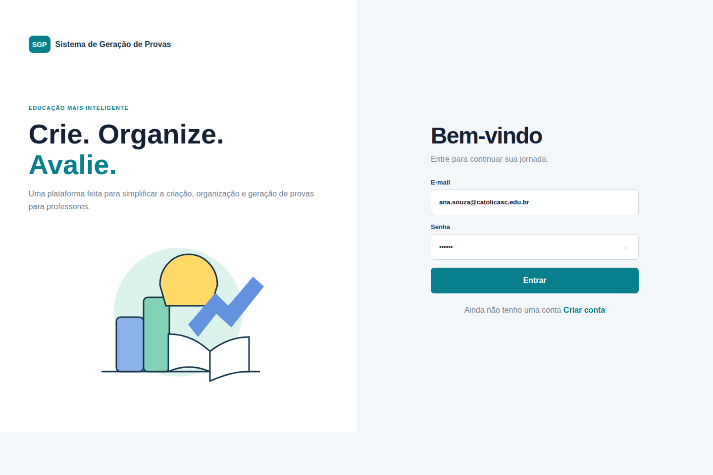
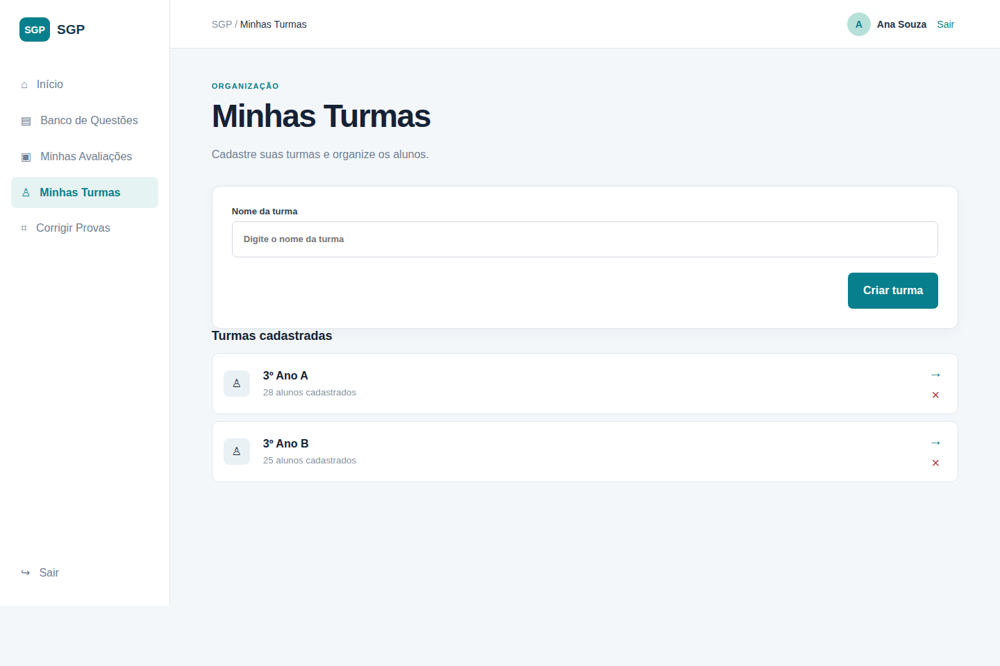
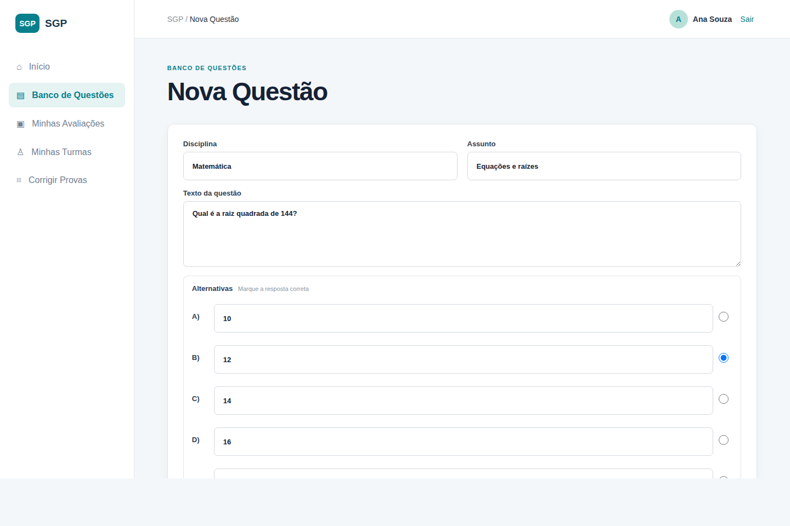
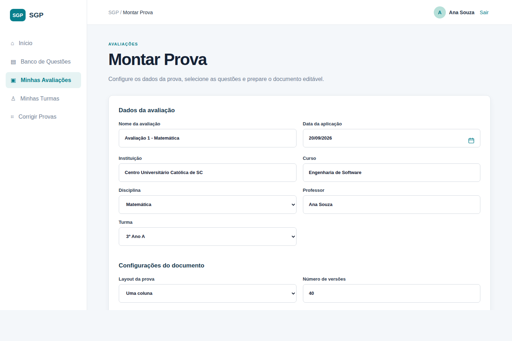
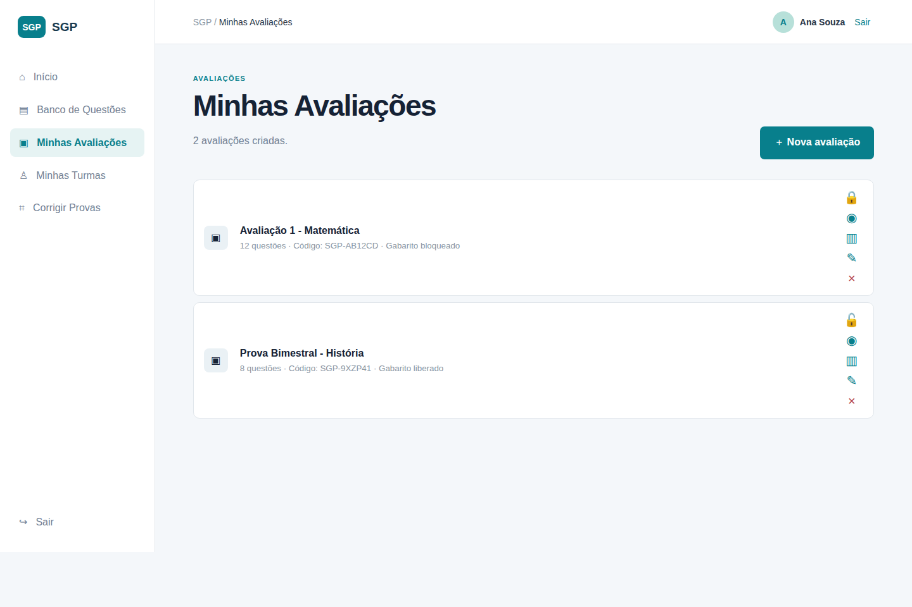
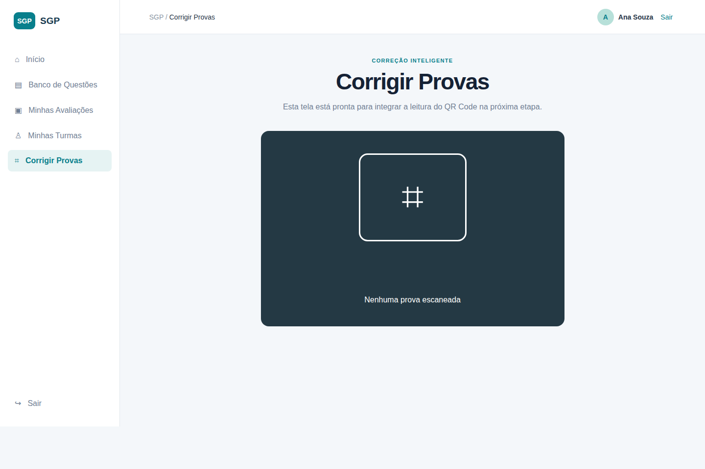
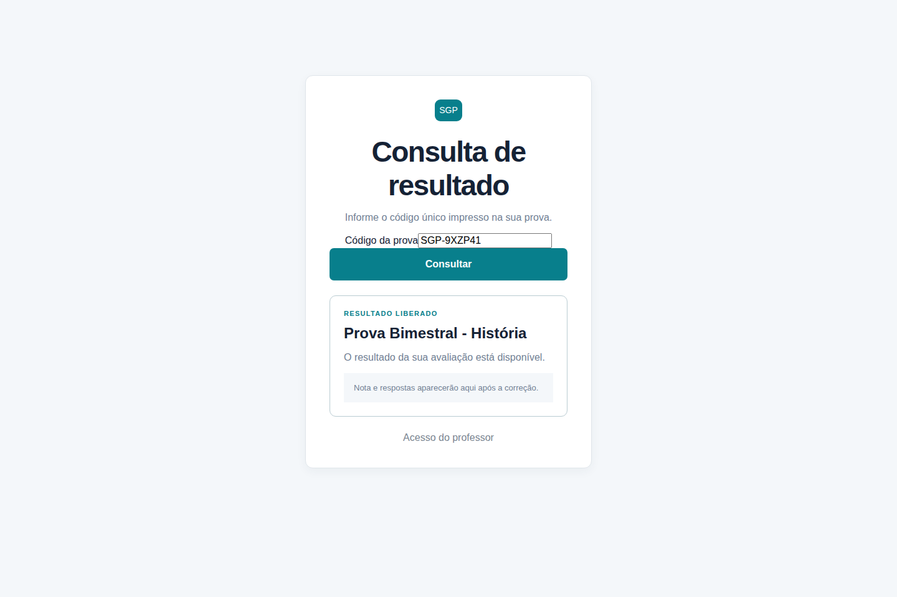

# Manual do Usuário — SGP

O SGP (Sistema de Geração de Provas) é acessado pelo navegador, no computador ou no celular: https://projeto-arquitetura-iota.vercel.app/

Este guia mostra o caminho do professor, do cadastro à nota lançada, e a consulta do aluno. Os nomes entre aspas são os das telas do menu lateral.

## Para o professor

### 1. Entrar no sistema

Crie sua conta pela opção de cadastro (nome, e-mail e senha de pelo menos 8 caracteres) e entre com e-mail e senha. Depois de 5 tentativas erradas em 15 minutos, o login é bloqueado por um tempo.

### 2. Cadastrar as turmas e os alunos

Em **"Minhas Turmas"**, crie a turma. Há três formas de colocar alunos nela:

- **Código de convite:** passe o código da turma e o aluno entra informando código, RA e nome.
- **Cadastro manual:** informe nome e RA.
- **Importar CSV/Excel:** envie um arquivo `.csv` ou `.xlsx` com as colunas **nome** e **RA** (na primeira aba, no caso do Excel). A primeira linha pode ser o cabeçalho. Ao final, o sistema informa quantos alunos entraram, quantos já estavam na turma e quais linhas tiveram erro (nome vazio, RA vazio ou repetido).

### 3. Montar o banco de questões

Em **"Banco de Questões"**, use **"Nova Questão"** para informar o enunciado, de 2 a 5 alternativas e qual é a correta. A busca e os filtros ajudam a achar questões por disciplina e assunto.

### 4. Montar a prova

Em **"Montar Prova"**, escolha as questões (até 25 por prova), defina os pontos de cada uma, o número de versões e, se for o caso, a turma que vai fazer a prova. Ao salvar, o sistema gera as versões embaralhando a ordem das questões e das alternativas. A **pré-visualização** mostra como ficam o caderno e a folha de respostas. O cabeçalho (instituição, logo, orientações) é configurado em **"Configurações"**.

Se você só precisa corrigir uma prova que já tem pronta no papel, use **"Folha avulsa"**: informe o nome, o número de questões (até 25) e o gabarito.

### 5. Imprimir

Em **"Minhas Avaliações"**:

- **PDF:** baixa o caderno com a folha de respostas. Para uma avaliação aplicada a uma turma, o arquivo traz a prova de cada aluno com nome, RA e QR Code próprios; sem turma, o QR identifica só a versão.
- **W (Word):** baixa o caderno editável em `.docx`, caso precise ajustar quebras de página.

Imprima em A4, sem reduzir a escala, para que a câmera leia as marcações corretamente. A folha de respostas tem **4 quadradinhos pretos** ao redor das bolhas: eles são usados na leitura pela câmera e não podem ser cortados, rabiscados ou cobertos. Folhas impressas antes desses marcadores existirem (antes de 25/11/2026) precisam ser geradas e impressas de novo para que as respostas sejam lidas pela câmera.

### 6. Corrigir pela câmera

Abra o sistema no celular, entre em **"Corrigir Provas"** e escolha a avaliação:

1. Enquadre **toda a área de respostas**: o QR Code, as bolhas e os 4 quadradinhos pretos. Se aparecer "QR Code encontrado. Afaste a câmera...", afaste o celular até os 4 quadrados entrarem no quadro.
2. Quando aparecer "Mantenha a câmera parada...", segure o celular firme: a leitura só é aceita quando duas imagens seguidas dão o mesmo resultado. O sistema identifica o aluno e a versão pelo QR Code.
3. As respostas lidas aparecem para **conferência**; questões em branco ou com mais de uma marcação são sinalizadas.
4. Corrija o que for preciso e confirme. A nota é calculada com o gabarito da versão do aluno.

Também é possível **lançar a nota manualmente** e **remover** uma nota lançada por engano.

### 7. Ver as estatísticas

Em **"Minhas Avaliações"**, o botão de estatísticas abre **"Estatísticas"**, com média, menor e maior nota e a distribuição das notas. Em **"Estatísticas por questão"** aparecem a taxa de acerto, quantas vezes cada alternativa foi marcada (com a correta destacada) e a alternativa incorreta mais marcada, que ajuda a identificar o conteúdo que a turma mais errou.

### 8. Exportar o relatório em Excel

Em **"Minhas Avaliações"**, o botão **XLSX** baixa a planilha `relatorio-avaliacao-<id>.xlsx` com duas abas:

- **Notas:** RA, nome e nota de cada aluno corrigido.
- **Respostas:** para cada aluno e questão, a versão, a alternativa marcada, a alternativa correta e a situação. Alunos com nota lançada manualmente aparecem como "Sem respostas registradas".

### 9. Liberar o gabarito

Em **"Minhas Avaliações"**, o cadeado 🔒/🔓 libera a consulta dos alunos. Enquanto estiver fechado, o aluno não vê nota nem gabarito.

## Para o aluno

1. Abra o sistema e acesse **"Consulta do aluno"** (ou o endereço `/aluno`).
2. Informe o **código da prova** impresso na folha (formato `SGP-XXXXXXXXXXXX`) e o seu **RA**.
3. Se o professor já liberou o resultado e corrigiu a sua prova, aparecem a **nota**, o total de acertos e, **questão por questão**, a alternativa que você marcou, o gabarito da sua versão e se você acertou.

Depois de 5 consultas em 15 minutos para o mesmo RA, a consulta é bloqueada temporariamente.

## Dúvidas comuns

| Situação | O que fazer |
|---|---|
| O aluno vê "Gabarito ainda não liberado". | O professor precisa liberar o gabarito da avaliação. |
| O aluno vê "Nota ainda não lançada". | A prova ainda não foi corrigida ou o RA não confere com o da avaliação. |
| O aluno vê a nota, mas não vê as questões. | A nota foi lançada manualmente; só a correção pela câmera grava as respostas por questão. |
| Não dá para gerar novas versões. | A avaliação já tem provas corrigidas; as versões ficam fixas depois da primeira correção. |
| A câmera não lê o QR Code. | Melhore a luz, evite reflexo e sombra, mantenha a folha plana e o QR inteiro no quadro. |
| A câmera lê o QR Code, mas nenhuma resposta aparece marcada. | A folha foi impressa sem os 4 quadradinhos pretos (versão antiga) ou eles ficaram fora do quadro. Gere e imprima a folha de novo, ou enquadre os 4 quadrados. Se preferir, digite as respostas no campo **"Respostas automáticas"** (ex.: `A, B, C`) ou lance a nota manualmente. |
