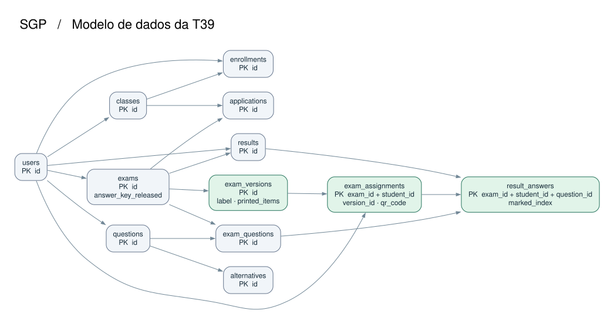

# Versões, atribuições e respostas da prova

Uma avaliação pode ter diversos cadernos. Cada aluno recebe uma versão daquela avaliação e um código de QR exclusivo. A nota continua em `results`. As marcações individuais ligam a nota e a atribuição pela chave da avaliação e do aluno.

O diagrama mostra as doze tabelas e as relações entre elas. As três tabelas em verde pertencem à T39. As setas vão da tabela referenciada para a dependente. Cada linha dependente referencia exatamente uma linha da tabela de origem, e uma origem admite zero ou mais dependentes. As chaves compostas e as exceções de unicidade estão detalhadas abaixo e no [DDL](../../database/schema.sql). [Fonte editável do diagrama](mer-der-t39.dot).

## Dicionário de dados

### exams

`answer_key_released` é um BOOLEAN obrigatório, com padrão FALSE e valores admitidos 0 e 1. A API usa esse campo para liberar a visualização do resultado. A migração converte avaliações anteriormente liberadas por `status='closed'` e conserva o valor de `status`.

### exam_versions

- `id` é a chave primária BIGINT UNSIGNED gerada automaticamente.
- `exam_id` é uma FK BIGINT UNSIGNED obrigatória de `exams.id`.
- `label` identifica o caderno, por exemplo A ou B. É VARCHAR(32) obrigatório e único por avaliação.
- `printed_items` é um JSON obrigatório com 1 a 20 itens na ordem impressa. Cada item contém `question_id` (ID inteiro positivo), `alternative_order` (2 a 5 índices originais, distintos, de 0 a 4) e `correct_index` (índice impresso da alternativa correta, de 0 a 4). A chave única `(exam_id,id)` permite que a atribuição valide avaliação e versão juntas.

### exam_assignments

- `exam_id` e `student_id` são BIGINT UNSIGNED obrigatórios. Juntos formam a chave primária. Cada aluno recebe uma atribuição por avaliação.
- `version_id` é BIGINT UNSIGNED obrigatório. A FK `(exam_id,version_id)` identifica um caderno daquela avaliação.
- `student_role` é VARCHAR(9) obrigatório com valor fixo `aluno`. A FK `(student_id,student_role)` exige um aluno cadastrado em `users`.
- `qr_code` é VARCHAR(96) ASCII obrigatório, único no banco e sensível a maiúsculas e minúsculas. O código identifica a atribuição. Na integração, gere um identificador opaco e use a chave única para detectar colisões. O valor previsível do seed serve apenas para a demonstração.

### result_answers

- `exam_id`, `student_id` e `question_id` são BIGINT UNSIGNED obrigatórios e formam a chave primária. Há no máximo uma marcação por aluno, avaliação e questão.
- `(exam_id,student_id)` referencia tanto a atribuição quanto a nota em `results`. Uma nota anterior à T39 pode continuar sem respostas detalhadas.
- `(exam_id,question_id)` referencia `exam_questions` e exige que a questão pertença à avaliação.
- `marked_index` é TINYINT UNSIGNED opcional. Valores de 0 a 4 identificam A a E na folha entregue. NULL registra uma resposta em branco. A ausência da linha significa que a resposta ainda não foi registrada.

## Contrato proposto para a T42

O primeiro item do array ocupa a questão 1 da folha. As posições de alternativas começam em zero. Se a ordem das alternativas for `[1,2,0]`, A impressa corresponde a B original, B a C, e C a A. Se B era a correta, `correct_index` é 0. Para comparar versões em relatórios, use `question_id` e converta a marcação impressa com `alternative_order[marked_index]`. Para corrigir, compare `marked_index` com `correct_index` do mesmo item. Trate NULL como branco antes da conversão.

Ao montar a versão, a T42 deve usar as questões e os pesos da avaliação e as alternativas congeladas em `questionSnapshots`. Confira que cada questão aparece uma vez, que a ordem é uma permutação das alternativas disponíveis e que o índice correto corresponde ao gabarito original. Essa validação depende do conteúdo de cada prova. A restrição JSON no banco valida a forma e os limites gerais. Ao ler a folha, valide a marcação contra a quantidade de alternativas daquele item. Na atribuição, confira a matrícula na turma da aplicação.

Versões, atribuições e respostas devem permanecer associadas ao caderno que foi impresso. A geração com semente, as rotas de versões e o bloqueio de regeneração depois da correção pertencem à T42. Para gravar o resultado individual, use uma única transação para a nota e as respostas. O fluxo público existente exibe a nota somente após a liberação e o fornecimento do RA correspondente.

## Instalação e teste

Em um banco novo, aplique `database/schema.sql` e, para demonstração, `database/seed.sql`. No esquema N2 já povoado, pare as escritas da API, faça backup e execute `node database/migrations/003-t39.cjs` na raiz do projeto com DB_NAME e as opções de conexão do projeto. A migração preserva as nove tabelas e a situação de liberação das provas, e pode ser repetida. Inicie a API atualizada depois da migração. O seed contém dados fictícios e destina-se a desenvolvimento e testes.

Para verificar, instale as dependências com `npm ci`. Execute `node database/test-schema.cjs` com DB_HOST, DB_PORT, DB_USER e DB_PASSWORD de uma instância de teste. O usuário de teste precisa poder criar e excluir bases temporárias. Execute `npm test` para a suíte de API. Consulte o [exemplo SQL](../../database/consultar-t39.sql) em uma base com o seed.
