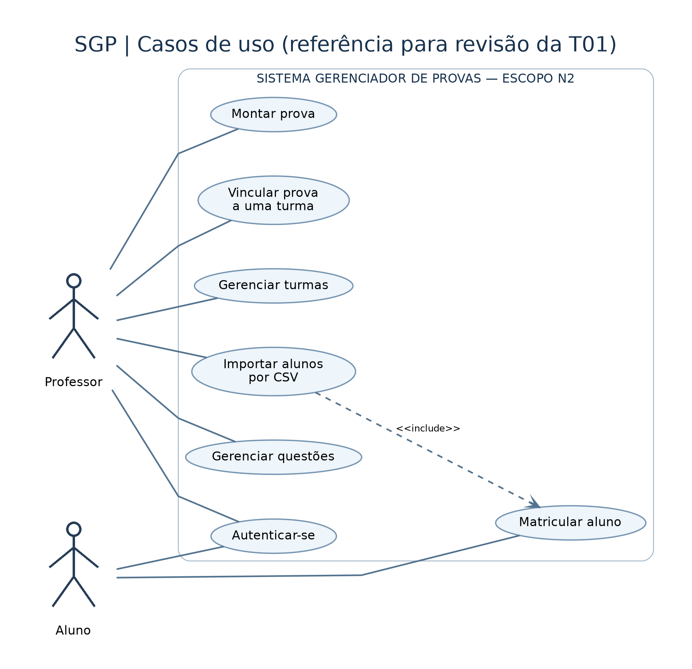
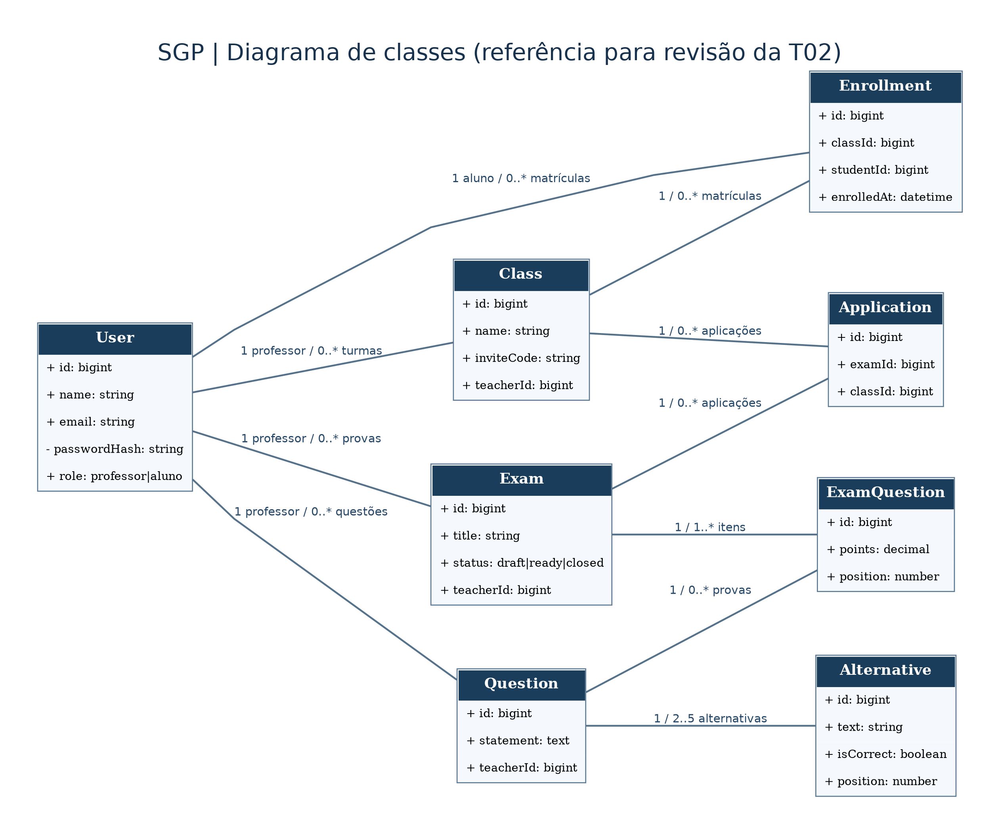
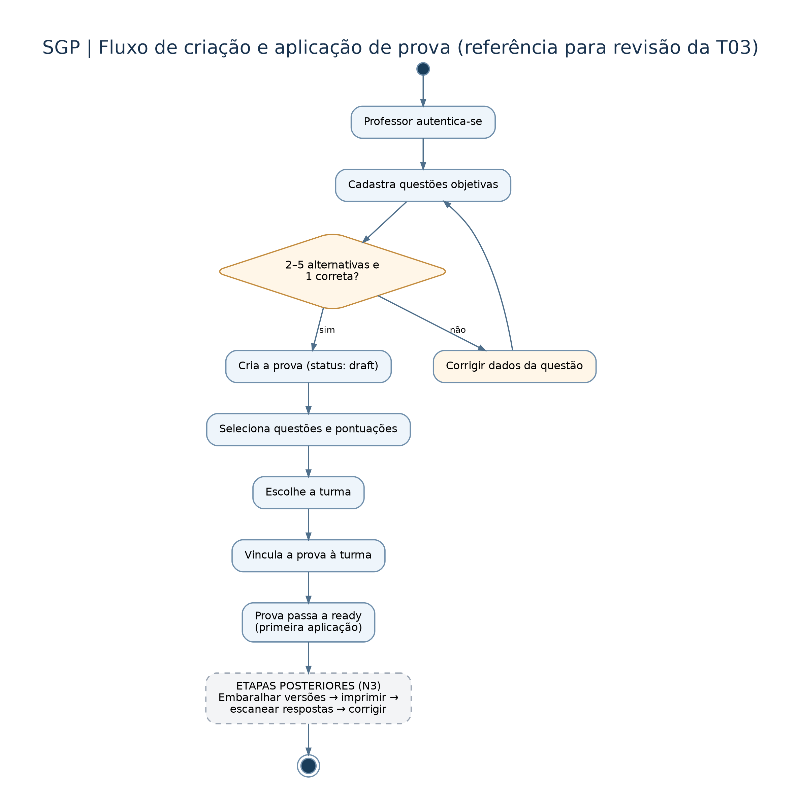
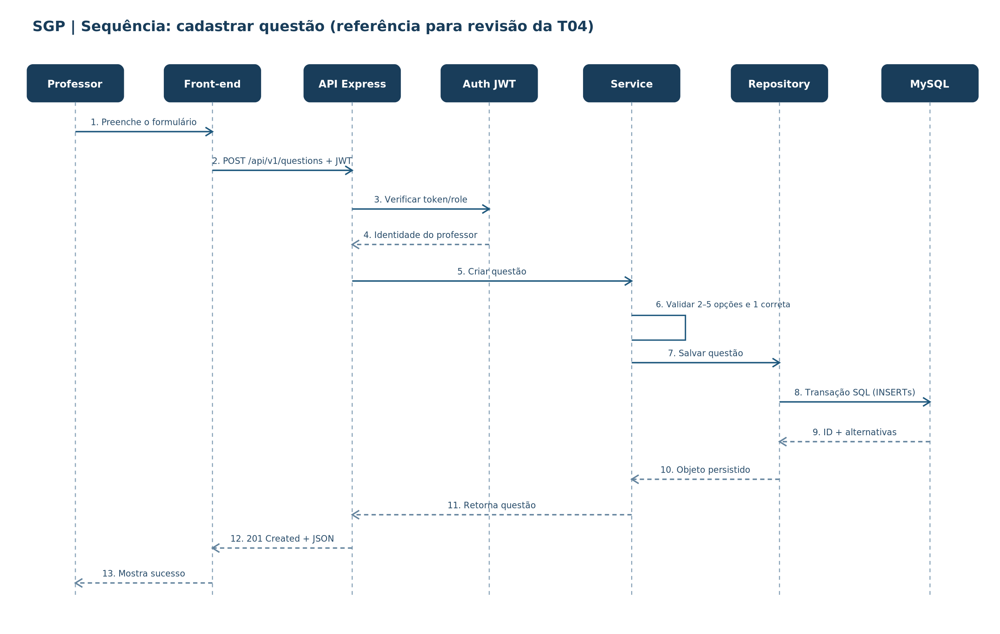

# Revisão dos quatro diagramas da N2 Parte 1

Responsável pela T05: Gabriel Hoeft Tissi. Prazo: 16/10/2026, às 23h59.
Esta revisão adota os diagramas do documento
N2_Parte1_SGP_Gabriel_editavel.docx fornecido por Gabriel.

Os quatro PNGs foram extraídos diretamente desse documento. Os arquivos .puml
transcrevem o modelo para edição futura; o layout de uma nova renderização pode
ser diferente. As etapas ilustrativas do DOCX não são evidências de commits ou PRs.

## Casos de uso

[Editar fonte PlantUML](casos-de-uso.puml).

1. Identificar Professor e Aluno como atores externos.
2. Delimitar a fronteira do SGP e o escopo N2.
3. Relacionar professor a autenticação, turmas, importação CSV, questões,
   montagem de provas e vínculo da prova à turma.
4. Relacionar aluno à autenticação e matrícula.
5. Registrar que importar CSV inclui matricular aluno.
6. Conferir que correção por câmera, versões e relatórios não aparecem como
   entregas concluídas da N2.

Revisão: atores, fronteira e inclusão estão representados. O fluxo de matrícula
do aluno e a autenticação são requisitos, não uma declaração de implementação.

## Classes

[Editar fonte PlantUML](classes.puml).

1. Identificar User, Class, Enrollment, Question, Alternative, Exam,
   ExamQuestion e Application.
2. Representar o papel professor/aluno em User, com passwordHash privado.
3. Relacionar professor a suas turmas, questões e provas.
4. Representar matrículas por Enrollment: um aluno pode ter várias matrículas.
5. Definir 2–5 alternativas por questão e uma única isCorrect verdadeira.
6. Representar points e position em ExamQuestion, com ID próprio.
7. Associar prova à turma por Application, permitindo reutilização da prova.
8. Conferir o DDL da T07 e registrar as regras que precisam do service.

Revisão: o schema da T07 usa estas oito entidades, com atributos SQL em
snake_case. A regra 1..* itens vale para prova pronta/aplicável; um draft pode
estar em construção. Exatamente uma correta e mínimo de duas alternativas
devem ser validados transacionalmente pela T12. O schema limita a cinco
posições e impede duas alternativas corretas.

## Atividades

[Editar fonte PlantUML](atividades.puml).

1. Iniciar com professor autenticado.
2. Preencher questão e verificar 2–5 alternativas e uma correta.
3. Voltar ao preenchimento quando inválida.
4. Criar prova draft e adicionar questões/pontuações.
5. Escolher turma e registrar Application.
6. Alterar draft para ready na primeira aplicação.
7. Separar geração de versões e correção como trabalho futuro da N3.
8. Conferir início, fim, decisões e retorno de erro.

Revisão: prova e aplicação são etapas distintas; os estados estão consistentes
com Exam. As APIs T15/T16 ainda devem executar essa transição em transação.
Este diagrama não afirma que a correção automática esteja pronta.

## Sequência

[Editar fonte PlantUML](sequencia.puml).

1. Escolher o cadastro de questão pelo professor autenticado.
2. Dispor Professor, Front-end, API Express, Auth JWT, Service, Repository e MySQL.
3. Enviar POST /api/v1/questions com Bearer JWT.
4. Validar assinatura, expiração e papel, usando a identidade do token.
5. Validar enunciado, alternativas e resposta correta no service.
6. Persistir questão e alternativas na mesma transação.
7. Confirmar commit antes de devolver 201 com JSON.
8. Tratar 400, 401 e 403 conforme o cenário; a fonte inclui rollback em falha SQL.

Revisão: a rota é o contrato previsto para T11/T12, posteriores a 16/10.
A T09 entrega a infraestrutura em camadas e /health; não declara o cadastro
de questões entregue nesta etapa.

## Conferência dos trabalhos do grupo

Os arquivos oficiais presentes na main foram inspecionados. Os PRs de casos
de uso (#9), classes (#15), atividades (#16) e sequência (#14) estão mesclados.
Os modelos anteriores permanecem em docs/uml e no histórico.

Diferenças encontradas: o modelo antigo separava Professor/Aluno, limitava aluno
a uma turma e ligava avaliação diretamente à turma. A sequência antiga tratava
montagem de avaliação. A referência de Gabriel unifica User, usa Enrollment
e Application e escolhe cadastro de questão para a sequência. Esta revisão
documenta explicitamente a referência adotada sem atribuir sua autoria aos colegas.

Links dos PRs originais:
- [Casos de uso #9](https://github.com/Erickdemathe123/projeto-arquitetura-/pull/9)
- [Classes #15](https://github.com/Erickdemathe123/projeto-arquitetura-/pull/15)
- [Atividades #16](https://github.com/Erickdemathe123/projeto-arquitetura-/pull/16)
- [Sequência #14](https://github.com/Erickdemathe123/projeto-arquitetura-/pull/14)

## Entrega

- [x] Quatro imagens conferidas e salvas no repositório.
- [x] Fontes editáveis e passo a passo de cada diagrama.
- [x] Diferenças de domínio e escopo N2/N3 documentadas.
- [x] PRs originais do grupo conferidos como mesclados.
- [ ] PR desta revisão integrado à main.
- [ ] Arquivo enviado na atividade N2 Parte 1 do portal.
- [ ] Comprovante de envio salvo.

A conclusão da T05 depende da revisão final integrada e do envio ao portal.
As capturas do GitHub comprovam PRs/commits; não substituem o recibo do portal.
